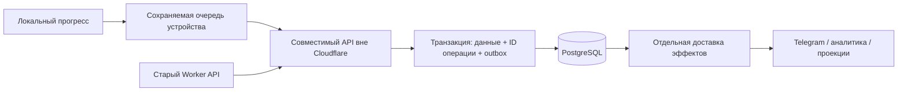

# Надёжность аккаунтов, прогресса и входа: исследование 24.10.2026

Статус: исследование и проект решения. Проверен код `7b31c18c`, исходники
мобильного релиза `dfe6028a` (2.2.5+66), production-логи и метрики Cloudflare.
Новые платные сервисы, перенос данных и изменение production-архитектуры
в рамках этого исследования не выполнялись.

## Решение

Обязательная основа — сохраняемая очередь изменений на устройстве,
подтверждение их приёма сервером и независимая обработка служебных эффектов.
Эти свойства нужны при любом поставщике базы. Сейчас локальное сохранение
уже есть, но гарантированной досылки и однозначного подтверждения недостаточно.

Целевая архитектура для независимости от Cloudflare: совместимый API на
отдельном хостинге и управляемый PostgreSQL как единственный источник
аккаунтов, прогресса, отзывов сессий и платёжного журнала. Cloudflare может
обслуживать статистику, публикации и старый адрес API. Переход — после локального
прототипа и проверки сетей, с одним писателем и сверкой данных. Немедленно
копировать KV в новую базу и переключать всех пользователей небезопасно.

Практический первый этап — устранить подтверждённые архитектурные зависимости
в текущем сервере и клиенте, исправить поток Яндекса и измерить результат.
Параллельно готовить PostgreSQL-адаптер. Решение о production-переносе принимать
по результату пилота, а не по количеству сообщений в Telegram.

## Что означают последние сообщения

| Время МСК | Наблюдение | Вывод |
| --- | --- | --- |
| 11:32:03 | `api.user.progress.sync`, `durable_memory_exhausted`, 503 | Реальная серверная ошибка SQLite. Она возникла до изменения обработки инфраструктурных отказов в 11:38:38 и объединения Telegram в 11:56:01. Это не новый отказ после последнего деплоя. |
| 12:06:10 | Яндекс, iOS 2.2.5+66, `auth.provider/sdk_error` | Отдельная ошибка входа. По этому коду нельзя определить SDK, конфигурацию, callback, локальное завершение или точный сетевой этап. |

В доступной выборке `auth_session` нет выдачи сессии около 12:06. Общего ID
между этой клиентской ошибкой и серверным запросом нет, поэтому по отсутствию
совпадения нельзя окончательно установить этап отказа. В build 66 весь вход
ещё назывался `auth.provider`, включая поздние локальные ошибки.

В окне 12:16:56–12:19:58 МСК наблюдались 258 внешних HTTP-ответов 200,
включая 85 запросов прогресса, 14 проверок Premium и 114 чтений поддержки.
Новых серверных исключений в этой короткой выборке не было. Это текущая
проверка, а не доказательство отсутствия редких сбоев или успешного входа Яндекса.

## Подтверждённые проблемы нашего кода

### 1. Успешное сохранение зависит от последующей служебной работы

`AccountState.handle()` после основной транзакции ждёт эффекты, `flush()`
и ещё одно чтение хранилища. Чтения аккаунта также запускают этот путь:
[account_state.js](../../server/install-notifier/account_state.js), блок после
`response.status < 500` (на исследованном SHA строки 277–283).

Локальное внедрение отказа воспроизвело последовательность:

1. Ответ на вопрос транзакционно сохранён в авторитетном DO.
2. Чтение очереди проекции выбрасывает искусственный `SQLITE_NOMEM`.
3. Клиент получает 503, хотя ответ уже сохранён.
4. Следующий GET тоже получает 503, потому что запускает то же обслуживание.
5. После снятия отказа GET возвращает 200 с сохранённым ответом.

Это доказанный сценарий нашего кода. Он не доказывает, что конкретная
production-ошибка произошла именно после commit.

Исправление: чтение не должно запускать чужие ремонты; подтверждение основной
транзакции не должно ждать KV, Telegram, статистику и прочие внешние сервисы.
Durable-effects и проекции уже сохраняются транзакционно — их нужно завершать
отдельным событием, с гарантированным alarm и контролем отставания. Остальные
`__AFTER_ACCOUNT_COMMIT`/`effects[]` остаются в памяти; их нельзя считать
сохраняемой очередью, и нужную для восстановления работу следует перевести
в явные durable-задания.
Один `try/catch` вокруг flush недостаточен: нативная ошибка storage может
разрушить output gate Cloudflare и не дать отправить даже подготовленный ответ.

Нужно сохранить специальный checkpoint перед внешним созданием платежа
([payments.js](../../server/install-notifier/payments.js)): заказ и его
принадлежность должны быть надёжно зафиксированы до обращения к провайдеру.
Нельзя механически сделать асинхронными все платёжные зависимости.

### 2. В клиенте нет гарантированного продолжения синхронизации

[ProgressSyncService](../../lib/data/services/progress_sync_service.dart)
возвращается при `_isSyncing`, не ставя следующую попытку. При 503 нет
сохраняемого состояния ожидания и собственного backoff до подтверждения.
Следующее действие или запуск обычно запустит синхронизацию, но это не
надёжный протокол доставки последнего изменения.

Отдельный Flutter-эксперимент с настоящими сервисами и мокированным HTTP:

- Первый снимок отправлен, ответ задержан более трёх секунд.
- Второй ответ сохранён локально; его debounce истёк во время первой отправки.
- Первый запрос успешно завершён.
- В отправленном снимке второго ответа нет; автоматическая досылка не назначена.
- Локальный второй ответ остался цел — это задержка доставки, а не потеря на телефоне.

Нужны локальные ревизии и подтверждённая сервером ревизия, привязанные к аккаунту.
Изменение во время отправки помечает следующую ревизию ожидающей; завершение
старой отправки не очищает её. Очередь переживает перезапуск и смену сети.
Повторы используют тот же ID операции и увеличивающуюся паузу с jitter,
учитывают Retry-After. Выход и смена аккаунта не отправляют чужую очередь.
На iOS нельзя обещать выполнение фонового таймера после выгрузки приложения;
доставка возобновляется при следующем допустимом запуске/foreground.
Это развитие уже имеющегося локального сохранения по
[официальной схеме offline-first Flutter](https://docs.flutter.dev/app-architecture/design-patterns/offline-first).

### 3. `idempotent: true` ещё не даёт атомарной дедупликации

[NotifierApi](../../lib/data/services/notifier_api.dart) уже разрешает повтор
снимка при сетевой ошибке, но произвольный 503 возвращает вызывающему коду.
На границе Worker → DO записи намеренно не повторяются вслепую.

Для нового контракта сервер в одной транзакции сохраняет изменение, его ID,
хеш канонического намерения и подтверждённый результат. ID привязан к аккаунту
и операции; порядок JSON-полей и исключённые служебные метаданные должны иметь
явные правила нормализации. Повтор того же ID возвращает тот же результат;
другое намерение с этим ID отклоняется. Срок защиты должен покрывать
допустимую задержку офлайн-очереди. Таймаут после commit не создаёт новую операцию.
Серверная очередь вторичных эффектов сохраняется в той же транзакции, а её
потребители также подавляют повторы. Основа —
[идемпотентные API](https://aws.amazon.com/builders-library/making-retries-safe-with-idempotent-APIs/)
и [транзакционный outbox](https://docs.aws.amazon.com/prescriptive-guidance/latest/cloud-design-patterns/transactional-outbox.html).

Для Platega это не разрешение повторять внешний POST: провайдер не даёт нам
подтверждённого контракта идемпотентного создания. `creation_unknown`, проверка
статуса и сверка заказа остаются обязательными. Покупки не объединяются с
обычным повтором синхронизации.

### 4. Поток Яндекса содержит лишнюю сеть и недостаточную диагностику

После успешного нативного SDK клиент обязательно вызывает `/info`, прежде чем
отправить credential серверу. Сервер всё равно повторно проверяет его через
Яндекс и возвращает профиль. Этот дополнительный запрос с телефона можно
убрать, не меняя `yandex_<id>` и принадлежность Premium:
[auth_service.dart](../../lib/data/services/auth_service.dart),
[yandex_auth_sheet.dart](../../lib/presentation/widgets/yandex_auth_sheet.dart),
[user_auth.js](../../server/install-notifier/user_auth.js).

В bridge есть `sdk_unavailable`, `no_presenter`, `sign_in_in_progress`,
`missing_credential`, но общий классификатор может превратить их в `sdk_error`.
Ошибка callback может оставить незавершённый `pendingResult`. Это риск в коде,
а не установленная причина сообщения 12:06. Нативные XCTest сейчас шаблонные;
мок MethodChannel не проверяет возврат из реального SSO на iPhone.

План: credential → проверка и профиль с сервера; безопасные фиксированные
коды и этапы; гарантированное завершение попытки; защита от позднего callback
предыдущей попытки. Для известного NSError сохранять только разрешённый домен
и числовой код. URL, localizedDescription, PKCE, токены и словари SDK не логировать.
Запасной пользовательский путь — вход в тот же Яндекс через системный браузер,
с сохранением state/PKCE. Google и Apple здесь другие аккаунты, их нельзя
представлять как равнозначное восстановление уже купленного Premium.
Возможность `.webOnly` и системный ASWebAuthenticationSession есть в
[официальном SDK Яндекса](https://github.com/yandexmobile/yandex-login-sdk-ios/blob/3.2.0/Sources/YandexLoginSDK/Public/YandexLoginSDK.swift);
поведение callback описано в [документации методов](https://yandex.ru/dev/id/doc/ru/mobileauthsdk/ios/2.1.1/sdk-ios-methods).

### 5. Рост служебных документов требует отдельного ограничения

Отсутствующий `revoked_session:<account>:<hash>` записывается в DO как
постоянный документ с null. У каждой сессии новый hash; истёкшие записи тоже
становятся бессрочными null. Обход обслуживания со временем растёт.
Нужно ограничить срок таких записей проверенным expiry соответствующего токена.
`auth_generation`, удаление аккаунта и финансовые tombstones при этом сохранять.
Это обнаруженный долгосрочный риск, не доказанная причина сегодняшнего NOMEM.

## Что удалось проверить по памяти

| Проверка | Результат | Предел вывода |
| --- | --- | --- |
| KV-проекции 8 365 документов прогресса | Медиана 4 544 B, P99 141 386 B, максимум 215 363 B | Это не полный объём DO и не измерение его аллокатора. |
| KV-проекции 8 402 профилей | Максимум 2 123 B | Нет оснований обвинять огромный профиль пользователя. |
| Реальный локальный workerd/SQLite, 100 аккаунтов, 10 раундов, параллельность 10 | Документы Unicode 340 024 B; 1 100 успешных операций, 0 отказов за 23,3 с | Очевидная детерминированная ошибка chunks на этой нагрузке не воспроизвелась. Hosted-лимиты могут отличаться. |
| Production GraphQL, AccountState, 09:00–12:20 МСК | V8 P99 29,4 MB; P999 45,6 MB | Это процентили всего isolate, не максимум и не память SQLite; короткий пик не исключён. |

`SQLITE_NOMEM` нельзя приравнивать к превышению 128 MB V8. Workerd отдельно
учитывает память SQLite; конкретный лимит из сообщения неизвестен.
[Исходники workerd](https://github.com/cloudflare/workerd/blob/main/src/workerd/util/sqlite.c%2B%2B#L1484-L1492),
[ограничения метрик памяти](https://developers.cloudflare.com/durable-objects/observability/metrics-and-analytics/).
Добавление `noCache` или искусственный reset объекта не считаются доказанным
лечением. Нужны этап операции, длительность, размер/chunks, ID DO, версия и
флаги ошибки, без содержимого пользовательских документов.

## Сравнение инфраструктуры

Цены проверены 24.10.2026, без налогов, миграции и дополнительного трафика.
Расчёт постоянно работающей БД: 0,25 CU × 730 часов. Это ориентир пилота,
не смета требуемой мощности и не гарантия доступности из российских сетей.

| Вариант | Расход | Оценка для проекта |
| --- | --- | --- |
| Текущий Workers + DO | От $5, затем превышения | Устраняем найденные зависимости; сохраняется поставщик Cloudflare. |
| D1 | Может поместиться в Workers Paid | Тот же поставщик и SQLite. Сам по себе такой перенос не создаёт независимость. |
| Neon Launch | Около $19,35 compute + storage/history | Удобный недорогой PostgreSQL-пилот; SLA в Launch нет. |
| Neon Scale | Около $40,52 compute + storage/history | SLA доступности compute endpoint с исключениями; достаточность 0,25 CU ещё не проверена. Цена API добавляется; failover не мгновенный. |
| Supabase Pro | $25 с ежедневными backup; PITR отдельно | Для непрерывного восстановления требуется примерно ещё $100 и более крупный compute; итог около $130. Избыточно, если нужна только БД. |
| Один VPS + PostgreSQL | Например $6–12 за VM + backup | Даёт независимый путь, но создаёт одну точку отказа и требует собственного обслуживания БД. Это не готовое HA-решение. |

Источники: [Neon](https://neon.com/pricing), [его HA](https://neon.com/docs/introduction/high-availability)
и [SLA](https://neon.com/sla),
[Supabase](https://supabase.com/pricing) и [backup/PITR](https://supabase.com/docs/guides/platform/backups),
[DigitalOcean VM](https://www.digitalocean.com/pricing/droplets),
[D1](https://developers.cloudflare.com/d1/platform/pricing/).

Для пилота независимого API + Neon разумный ориентир — $30–60/мес с небольшим
compute и сохранёнными сервисами Cloudflare. Это не полный HA самого API:
две реплики, балансировщик, дополнительная мощность и проверенное восстановление
увеличат сумму. Scale включает SLA compute endpoint; выбор мощности и проверка
фактической доступности остаются обязательными. Launch подходит для проверки
адаптера и нагрузки. Free-планы не предлагаются как гарантия качества.
Финальную конфигурацию покупать только после сетевых замеров и согласования сметы.
SLA Neon касается compute endpoint и компенсаций с исключениями, а не всего
нашего API, провайдеров входа или доступа через российских операторов.

## Независимый маршрут и старые клиенты

Оба текущих hostname ведут в тот же Worker. Замена только базы оставит
клиентский маршрут через Cloudflare. Сетевые ограничения в РФ возможны:
Cloudflare [официально описала ограничения операторов](https://blog.cloudflare.com/russian-internet-users-are-unable-to-access-the-open-internet/).
Это не причина установленного серверного NOMEM и не доказательство причины
конкретного отказа Яндекса. Замеры нужны минимум в нескольких российских
мобильных сетях и на домашнем интернете, отдельно на Wi-Fi/мобильной сети и
на запросах разных размеров.

Проверен именно исходник релиза `dfe6028a`: в 2.2.5+66 GET и идемпотентные POST
уже пробуют оба hostname при сетевом отказе; остальные POST используют один
предпочтительный адрес. HTTP 503 обычной синхронизации не запускает эту смену.
Старое описание «fallback только для входа/диагностики» устарело.

Нельзя перенаправить DNS чужой зоны workers.dev на свой хостинг. На старом
адресе нужен адаптер совместимости. Для независимого маршрута основным адресом
в новом клиенте станет отдельный домен; резервные адреса должны иметь реально
разные инфраструктурные пути. Сам факт второго hostname не даёт отказоустойчивость.

## Целевая схема

Клиент не подключается к БД напрямую. Проверка провайдеров и существующих
сессий остаётся на сервере. Перенос базы не требует смены на Supabase Auth,
новых user ID или объединения разных провайдеров.

## Последовательность внедрения

1. **Текущий сервер.** Ввести диагностику этапов и отделить чтение от ремонта.
   Разделить основную транзакцию и фоновую проекцию. До изменения общей политики
   KV описать её отставание, alarm recovery и новый порядок отката — сейчас
   документация требует немедленную проекцию. Проверить отдельный платёжный
   checkpoint и восстановление после рестарта.
2. **Клиентский выпуск.** Исправить Яндекс, добавить подтверждаемую очередь
   прогресса, повторы с jitter/Retry-After и обработку изменений во время отправки.
   Не включать бесконечные циклы запросов и не показывать фоновые технические
   отказы как поломку обучения. Интерактивный отказ входа должен иметь понятное
   восстановление тем же способом входа.
3. **PostgreSQL-прототип.** Совместимый v1 API для старых клиентов; новые таблицы
   аккаунтов, прогресса, mutations, entitlements/ledger, claims, revocations и
   outbox. Поднять локально, прогнать существующие контракты с внедрением отказов,
   затем пилот поставщика и сеть. Не менять одновременно всё хранилище и авторизацию.
4. **Перенос с одним писателем.** Экспортировать авторитетные DO, включая chunks,
   auth generation/revocations, deletion tombstones, Apple authorization,
   ownership/claims, payment directory и незавершённые эффекты. KV-копии недостаточно.
   Сначала DO пишет журнал переноса, PostgreSQL догоняет и сравнивается в shadow-read.
   Затем fence/epoch закрывает старому писателю запись и передаёт полномочия
   новому. Независимый dual-write не допускается.
5. **Пилот и расширение.** Последовательно тестовые аккаунты, малая когорта,
   дальнейшее расширение после проверки. Запоздалые webhook должны попадать
   к единственному владельцу записи. Откат после новых PostgreSQL-записей требует
   обратной сверки и передачи писателя; возврат к старой KV-проекции недопустим.

## Проверяемые условия готовности

- Подтверждённые сервером ответы, сбросы, избранное и покупки сохраняются после
  аварийного перезапуска; недоставленные изменения остаются в локальной очереди.
- Потерянный ответ после commit, десять повторов одного mutation, два устройства,
  смена аккаунта, поздний reset и длительный offline не создают дублей и не
  возвращают старое состояние.
- На отказ Telegram/статистики/KV-проекции чтение и подтверждённая запись
  основного прогресса продолжают работать. На отказ основной БД нет ложного 200.
- Сессии отзываются сразу, удалённый аккаунт не воскресает из backup/поздней оплаты.
  Один чек/заказ — один владелец и одно начисление; Premium не берётся из клиента.
- На подписанном iPhone проверить Яндекс установлен/не установлен, отмену,
  двойное нажатие, callback после фонового состояния, пропавшую сеть и повтор.
  Отдельно — вход прежним способом и восстановление уже купленного Premium.
- Провести восстановление из backup/PITR в изолированную среду и сверить
  ledger/entitlements, а не ограничиваться наличием галочки backup.
- Предлагаемые SLO перед переносом: не менее 99,9% успешных запросов критического
  API за 7 суток; здоровая очередь догоняет изменения за 30 секунд после
  возобновления доступной сети и активности приложения. Это цели приёмки,
  а не уже достигнутые гарантии. Считать по операциям и затронутым аккаунтам,
  отдельно от количества Telegram-сообщений и отмен пользователем.

Свидетельства текущего исследования находятся в игнорируемых `output/` и
`scratch/`: результаты fault injection, SQLite stress, клиентского теста,
GraphQL памяти и текущего tail. В отчёт включены только агрегаты и технические
коды; пользовательские документы, ключи и callback URL не публиковались.
