# Следующая очередь: 10 статей

Редакционная копия подготовлена 22 октября 2026 года. Выход по МСК: понедельник, среда и пятница, 16 ноября — 7 декабря. Источники публикации — `source.json`; ссылки на них и оригинальные изображения приведены у каждой статьи. Текст ниже включает основной материал, FAQ и источники.

| Дата | Статья | Исходник |
| --- | --- | --- |
| 2026-11-16 | Разрешённая и фактическая масса в ПДД: как выбрать нужное число | [source.json](../../web_landing/ru/blog/razreshennaya-i-fakticheskaya-massa-pdd/source.json) |
| 2026-11-18 | Остановка дольше пяти минут: посадка, высадка и три задачи ПДД | [source.json](../../web_landing/ru/blog/ostanovka-pyat-minut-posadka-vysadka-pdd/source.json) |
| 2026-11-20 | Перекрёсток или выезд со двора: как отличить в билете ПДД | [source.json](../../web_landing/ru/blog/perekrestok-ili-vyezd-so-dvora-pdd/source.json) |
| 2026-11-23 | Знаки или разметка: что главнее при противоречии в билетах ПДД | [source.json](../../web_landing/ru/blog/znaki-i-razmetka-chto-glavnee-v-biletah/source.json) |
| 2026-11-25 | Почему поворотник не даёт преимущества: три задачи ПДД | [source.json](../../web_landing/ru/blog/povorotnik-ne-daet-preimushchestva-pdd/source.json) |
| 2026-11-27 | Вопросы ПДД со словом «не»: как прочитать условие и выбрать нужный ответ | [source.json](../../web_landing/ru/blog/voprosy-pdd-so-slovom-ne/source.json) |
| 2026-11-30 | Тормозной и остановочный путь в билетах ПДД: три вопроса без путаницы | [source.json](../../web_landing/ru/blog/tormoznoy-i-ostanovochnyy-put-v-biletah/source.json) |
| 2026-12-02 | 5 и 15 метров в билетах ПДД: где остановиться у перехода и остановки | [source.json](../../web_landing/ru/blog/rasstoyaniya-v-biletah-pdd-perehod-ostanovka/source.json) |
| 2026-12-04 | Недостаточная и ограниченная видимость: как различать их в билетах ПДД | [source.json](../../web_landing/ru/blog/nedostatochnaya-i-ogranichennaya-vidimost-pdd/source.json) |
| 2026-12-07 | Объезд препятствия или обгон: как различить манёвры в билетах ПДД | [source.json](../../web_landing/ru/blog/obezd-prepyatstviya-ili-obgon-pdd/source.json) |

## 1. Разрешённая и фактическая масса в ПДД: как выбрать нужное число

Выход: 2026-11-16. Проверено: 2026-10-22.

[Исходник с разметкой и ссылками на изображения](../../web_landing/ru/blog/razreshennaya-i-fakticheskaya-massa-pdd/source.json).

[Обложка](../../web_landing/ru/blog/razreshennaya-i-fakticheskaya-massa-pdd/cover.jpg).

Разрешённая максимальная масса — установленный изготовителем предел для транспортного средства с грузом, водителем и пассажирами. Фактическая масса — сколько оно весит в рассматриваемой ситуации. Для билета важно не только число в тоннах, но и то, какую массу требует сравнить правило или знак.

Разберём определение из A/B и две задачи C/D. Они выбраны потому, что показывают разные основания решения, а не как рейтинг трудности. Условия, варианты и ответы перенесены из базы приложения без изменений. В своих занятиях сначала проверьте выбранную категорию: одинаковая картинка в другом комплекте не гарантирует одинаковый вопрос.

### Две массы: разные вопросы к одному автомобилю

| Что сравниваем | Что это означает | Чего не следует подставлять |
| --- | --- | --- |
| Разрешённая максимальная масса | Максимально допустимая масса, установленная изготовителем, включая ТС, груз, водителя и пассажиров | Только грузоподъёмность или только массу пустой машины |
| Фактическая масса | Масса автомобиля или состава в заданном состоянии | Максимальный предел вместо реально указанного веса |
| Разрешённая максимальная масса состава | Сумма разрешённых максимальных масс входящих в состав ТС по п. 1.2 | Только предел тягача, без прицепа |

Погрузка и выгрузка меняют фактическую массу. При решении обычной задачи не нужно уменьшать разрешённую максимальную массу до веса пустого автомобиля. Фраза «он едет без груза» сама по себе не меняет установленный изготовителем предел.

### Задача 1. Что входит в разрешённый максимум

A/B, билет 6, вопрос 1. Что называется разрешённой максимальной массой транспортного средства?

- Максимально допустимая для перевозки масса груза, установленная предприятием-изготовителем
- Масса снаряженного транспортного средства без учета массы водителя, пассажиров и груза, установленная предприятием-изготовителем
- Масса снаряженного транспортного средства с грузом, водителем и пассажирами, установленная предприятием-изготовителем в качестве максимально допустимой

Проверить ответ

Верно: Масса снаряженного транспортного средства с грузом, водителем и пассажирами, установленная предприятием-изготовителем в качестве максимально допустимой.

В определении из пункта 1.2 важны обе части: полный состав массы и установленный изготовителем максимум. Первый вариант описывает только перевозимый груз. Второй исключает водителя, пассажиров и груз. Оба теряют существенную часть определения.

Полезная запись после ответа: «Не груз, а всё транспортное средство в максимально допустимом состоянии». Это учебное сокращение, а не замена официальной формулировки. Если вы уверенно отвечаете, попробуйте объяснить, почему выгруженная машина не превращается автоматически в автомобиль с другой разрешённой максимальной массой.

### Задача 2. На знаке 10 т, машина фактически весит 8 т

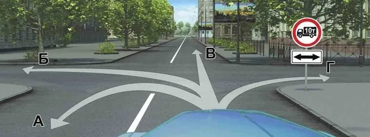

Комплект C/D, билет 31, вопрос 3. Исходная иллюстрация базы приложения, без перерисовки.

C/D, билет 31, вопрос 3. Вам разрешено продолжить движение на грузовом автомобиле с разрешенной максимальной массой 12 т при фактической массе 8 т:

- Только в направлении В
- В направлениях А и В
- В направлениях Б и Г
- В любом направлении

Проверить ответ

Верно: В направлениях А и В.

На рисунке знак 3.4 с числом 10 т и табличкой направлений действия. В условии разрешённая максимальная масса грузовика 12 т, фактическая — 8 т. Знак 3.4 сравнивает именно разрешённую максимальную массу. Поэтому рассуждение «8 меньше 10, значит, можно везде» использует неподходящую величину.

Запрет действует по пересекаемой дороге, что уточняет табличка. В данной задаче доступны направления А и В — разворот и движение прямо. Ответ определяется сочетанием вида знака, нужного показателя массы и направления действия. Одного сравнения двух чисел недостаточно.

Не переносите этот результат на любой знак с тоннами. У знака 3.11 нет силуэта грузового автомобиля: он регулирует другое условие. Следующий пример нужен именно для такого сравнения.

### Задача 3. Автомобиль и прицеп перед мостом

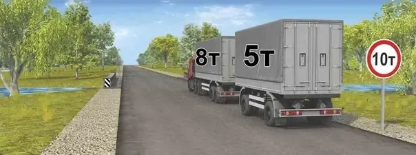

Комплект C/D, билет 28, вопрос 3. Исходная иллюстрация базы приложения, без перерисовки.

C/D, билет 28, вопрос 3. Можно ли проехать по мосту этому автопоезду, если фактическая масса автомобиля 8 т, а прицепа 5 т?

- Можно
- Можно только по разрешению Госавтоинспекции
- Нельзя

Проверить ответ

Верно: Нельзя.

Здесь установлен 3.11 «Ограничение массы» с числом 10 т. Он запрещает движение транспортных средств, в том числе составов, общая фактическая масса которых больше указанной. В условии даны фактические массы автомобиля и прицепа: 8 + 5 = 13 т. Сравнивать со знаком нужно весь состав, а не каждую его часть по отдельности.

Поэтому ответ — «Нельзя». Нельзя рассуждать «и 8, и 5 меньше 10»: автопоезд движется как состав. Вариант про разрешение Госавтоинспекции тоже не следует из показанного условия и не является правильным ответом этого билета.

### Как не перепутать 3.4 и 3.11

| Признак | 3.4 | 3.11 |
| --- | --- | --- |
| Содержание | Запрет движения грузовых автомобилей и составов по условиям описания знака | Ограничение общей фактической массы |
| Нужная величина в примерах | Разрешённая максимальная масса | Фактическая масса всего состава |
| Пример выше | 12 т сравниваем с 10 т | 8 + 5 т сравниваем с 10 т |

У каждого знака есть полное описание и предусмотренные исключения. Таблица показывает различие используемых величин, а не заменяет весь перечень условий действия. В экзаменационном вопросе учитывайте именно данные задания, таблички и тип транспортного средства.

### Короткое упражнение перед следующей попыткой

Закройте разбор и для каждой задачи запишите три поля: вид знака, какую массу он учитывает, какое число подставляете. Для автопоезда добавьте состав слагаемых. Если в записи остались только «12 больше 10», восстановите пропущенное слово «разрешённая»; именно оно связывает арифметику с правилом.

Затем решите другой вопрос о массе в своей категории. Не считайте верный ответ на знакомую картинку доказательством, что любые задачи с грузовиком уже понятны. Для общего контекста пригодятся [справочник дорожных знаков](https://pdd-drive.ru/blog/dorozhnye-znaki-2026/) и [разбор скоростных режимов](https://pdd-drive.ru/blog/skorostnye-rezhimy-pdd/): там масса может участвовать в других требованиях.

### Частые вопросы

#### Если грузовик пустой, его разрешённая максимальная масса уменьшается?

В обычной задаче нет: установленный изготовителем максимально допустимый предел не заменяется фактической массой пустого автомобиля.

#### Знаки 3.4 и 3.11 сравнивают одну и ту же массу?

Нет. В описании 3.4 используется разрешённая максимальная масса, а 3.11 — общая фактическая масса транспортного средства или состава.

#### Как считать фактическую массу автопоезда в примере?

Сложить данные фактические массы автомобиля и прицепа: 8 + 5 = 13 т. Со знаком 10 т сравнивается состав, а не каждая часть отдельно.

### Источники

- [ПДД РФ, пункт 1.2: определения массы, остановки, стоянки и перекрёстка](https://www.consultant.ru/document/cons_doc_LAW_2709/5894b193fda5648afe1c1a5e70c028f25cd29099/)
- [ПДД РФ, приложение 1: знаки 3.4, 3.11, 3.27 и 3.28](https://www.consultant.ru/document/cons_doc_LAW_2709/bf1f4781b8aa1172e9993c89c36db0dcdc88c495/)
- [ПДД РФ, приложение 1: таблички и правило о временных знаках](https://www.consultant.ru/document/cons_doc_LAW_2709/d507c6724f67c7a6ff27ba125eb7db3e4d36a3a6/)

### Практика после статьи

**Проверьте показатель массы в новом билете**

Выберите A/B или C/D и перед ответом назовите, какую массу требует учитывать условие.

[Открыть билеты PDD Drive](https://pdd-drive.ru/app/)

## 2. Остановка дольше пяти минут: посадка, высадка и три задачи ПДД

Выход: 2026-11-18. Проверено: 2026-10-22.

[Исходник с разметкой и ссылками на изображения](../../web_landing/ru/blog/ostanovka-pyat-minut-posadka-vysadka-pdd/source.json).

[Обложка](../../web_landing/ru/blog/ostanovka-pyat-minut-posadka-vysadka-pdd/cover.jpg).

Прекращение движения больше чем на пять минут не всегда является стоянкой: если большее время необходимо для посадки, высадки, загрузки или разгрузки, по определению ПДД это остановка. Но цель «высадить пассажира» не отменяет запреты остановки в конкретном месте.

В билетах удобно разделять два решения: сначала определить действие, затем проверить, разрешено ли оно здесь. Покажем это на трёх вопросах A/B. Подборка объясняет различие условий; она не является статистикой самых частых ошибок на экзамене.

### Пять минут: граница с оговоркой о цели

Пункт 1.2 определяет остановку как преднамеренное прекращение движения на время до пяти минут, а также на большее, если это необходимо для перечисленных действий с пассажирами или грузом. Стоянка — прекращение движения более чем на пять минут по причинам, с ними не связанным.

| Учебная ситуация | Что определяет действие | Что проверить отдельно |
| --- | --- | --- |
| Непродолжительное преднамеренное прекращение движения | Продолжительность до пяти минут | Допустимость остановки в месте |
| Высадка или разгрузка действительно требует большего времени | Связь необходимого времени с указанным действием | Знаки, разметку и общие запреты |
| Более пяти минут по другой причине | Признаки стоянки | Запреты стоянки и остановки |

Это таблица для преднамеренного прекращения движения. Ожидание разрешающего сигнала, необходимость уступить дорогу и вынужденная остановка требуют своего анализа. Не подменяйте определение правилом «машина стоит, значит, водитель припарковался».

### Задача 1. Посадка и разгрузка под знаком 3.28

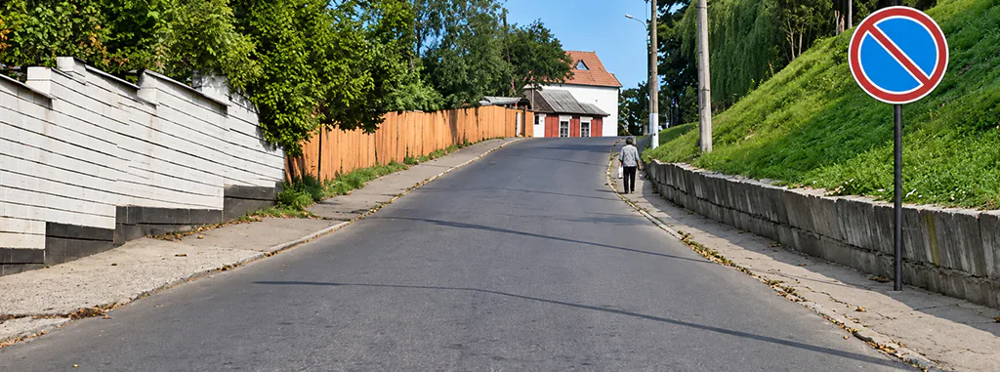

Комплект A/B, билет 19, вопрос 3. Исходная иллюстрация базы приложения, без перерисовки.

A/B, билет 19, вопрос 3. Разрешено ли осуществлять посадку (высадку) пассажиров либо загрузку (разгрузку) транспортного средства в зоне действия этого знака?

- Разрешено
- Разрешено, если это займет не более 5 минут
- Запрещено

Проверить ответ

Верно: Разрешено.

На рисунке «Стоянка запрещена». Спрашивают именно о посадке, высадке, загрузке и разгрузке. Поэтому правильный вариант не добавляет условие «не более пяти минут»: определение остановки допускает необходимое для этих действий большее время.

Важна формулировка «если это необходимо». Вопрос не разрешает использовать название разгрузки как оправдание для любого ожидания. Сначала установите действительную цель и условия прекращения движения. Затем помните границы решения: знак 3.28 не запрещает остановку сам по себе, однако общие требования раздела 12 продолжают действовать.

Знак 3.27 «Остановка запрещена» имеет другой смысл: он запрещает и остановку, и стоянку. Нельзя перенести ответ из этой картинки на соседнюю только потому, что оба знака синие с красной каймой.

### Задача 2. Посадка на остановке маршрутного транспорта

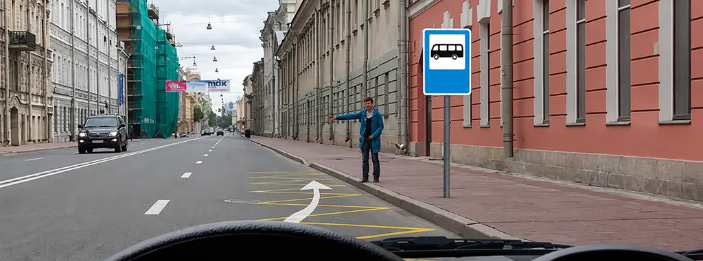

Комплект A/B, билет 3, вопрос 5. Исходная иллюстрация базы приложения, без перерисовки.

A/B, билет 3, вопрос 5. Можно ли Вам остановиться в этом месте для посадки или высадки пассажиров?

- Можно
- Можно, если при этом не будут созданы помехи движению маршрутных транспортных средств
- Нельзя

Проверить ответ

Верно: Можно, если при этом не будут созданы помехи движению маршрутных транспортных средств.

Здесь место обозначено знаком остановки и жёлтой зигзагообразной разметкой. В пункте 12.4 для посадки и высадки предусмотрено исключение из запрета у мест остановки маршрутных транспортных средств и стоянки легковых такси: нельзя создавать помехи соответствующему транспорту.

Поэтому неверны оба крайних сокращения — «обычной машине всегда нельзя» и «пассажира можно высадить без условий». Правильный ответ сохраняет условие об отсутствии помех. Подъезжающий автобус не должен менять движение из-за вашей посадки.

В полном тексте нормы учитываются также транспортные средства, используемые в качестве легкового такси. В приведённом варианте ответа базы названы маршрутные транспортные средства; читайте норму целиком, а вопрос — в его конкретной формулировке. Эта оговорка относится к обозначенному исключению и не снимает другие запреты в выбранном месте.

### Задача 3. Та же цель в тоннеле

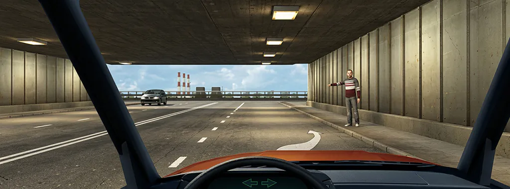

Комплект A/B, билет 37, вопрос 12. Исходная иллюстрация базы приложения, без перерисовки.

A/B, билет 37, вопрос 12. Можно ли Вам остановиться в тоннеле для посадки пассажира?

- Можно
- Можно, если Вы управляете легковым такси
- Нельзя

Проверить ответ

Верно: Нельзя.

Теперь слово «посадка» осталось, но место другое. Пункт 12.4 запрещает остановку в тоннелях. Для показанной преднамеренной остановки ради пассажира исключения нет. Поэтому верный ответ — «Нельзя»; вариант про легковое такси тоже не подходит.

Так видно, почему нельзя решать только по цели. В первой задаче запрет относился к стоянке, во второй у конкретной нормы имелось условное исключение, в третьей оно к посадке пассажира не предусмотрено. Длительность в одну минуту не делает третью остановку разрешённой.

### Три проверки перед выбором ответа

- Что происходит? Преднамеренная остановка, стоянка или иная ситуация? Опирайтесь на цель и время, заданные вопросом.
- Что запрещает место? Остановку, только стоянку или определённый способ расположения машины? Сопоставьте знак с разделом 12.
- Есть ли исключение именно здесь? Если есть, выполнены ли его условия, включая отсутствие помех?

Не пропускайте второй шаг после того, как правильно определили термин. Назвать действие остановкой — ещё не доказать его разрешённость. И не добавляйте в вариант ответа бытовой запас вроде «на пару секунд можно»: такого универсального исключения в ПДД нет.

### Как закрепить различие

Для каждого разобранного вопроса составьте запись из двух строк: «тип прекращения движения» и «норма места». Например, для 19–3 — остановка для посадки или разгрузки и знак 3.28; для 37–12 — преднамеренная остановка и тоннель. Не записывайте только номер кнопки: одинаковая цель в разных местах уже дала разные ответы.

Затем выберите в своей базе ещё одну задачу на остановку и до просмотра пояснения объясните оба шага. Для остальных расстояний и способов расположения используйте [общий разбор остановки и стоянки](https://pdd-drive.ru/blog/ostanovka-i-stoyanka-pdd/). Здесь задача уже: не превращать пять минут и посадку пассажира в универсальное разрешение.

### Частые вопросы

#### Разгрузка дольше пяти минут автоматически становится стоянкой?

Нет. Если большее время необходимо для загрузки или разгрузки, определение остановки в пункте 1.2 допускает такую продолжительность. Место всё равно должно допускать соответствующее действие.

#### Можно ли высадить пассажира под знаком «Остановка запрещена»?

Цель высадки сама по себе не отменяет знак 3.27. Не переносите на него ответ про знак 3.28 «Стоянка запрещена».

#### Можно ли посадить пассажира на автобусной остановке?

В предусмотренном пунктом 12.4 исключении посадка и высадка допускаются без создания помех маршрутным транспортным средствам или используемым как легковое такси ТС. Остальные запреты также нужно учитывать.

#### В тоннеле можно остановиться на минуту ради пассажира?

Нет. В приведённой ситуации преднамеренная остановка запрещена пунктом 12.4, независимо от короткой продолжительности и цели посадки.

### Источники

- [ПДД РФ, пункт 1.2: определения массы, остановки, стоянки и перекрёстка](https://www.consultant.ru/document/cons_doc_LAW_2709/5894b193fda5648afe1c1a5e70c028f25cd29099/)
- [ПДД РФ, раздел 12: остановка и стоянка](https://www.consultant.ru/document/cons_doc_LAW_2709/59ded54942baa2143676e12b31244b0cb7ada00d/)
- [ПДД РФ, приложение 1: знаки 3.4, 3.11, 3.27 и 3.28](https://www.consultant.ru/document/cons_doc_LAW_2709/bf1f4781b8aa1172e9993c89c36db0dcdc88c495/)

### Практика после статьи

**Отделите определение от запрета места**

Выберите билет своей категории и перед ответом проверьте тип остановки, знак и условия конкретного места.

[Практиковаться в PDD Drive](https://pdd-drive.ru/app/)

## 3. Перекрёсток или выезд со двора: как отличить в билете ПДД

Выход: 2026-11-20. Проверено: 2026-10-22.

[Исходник с разметкой и ссылками на изображения](../../web_landing/ru/blog/perekrestok-ili-vyezd-so-dvora-pdd/source.json).

[Обложка](../../web_landing/ru/blog/perekrestok-ili-vyezd-so-dvora-pdd/cover.jpg).

Выезд из двора или с другой прилегающей территории не считается перекрёстком. Поэтому нельзя назначить выезжающему преимущество только потому, что он находится справа. При выезде на дорогу действует пункт 8.3, а сначала нужно правильно определить сам объект.

Отличие влияет и на решение о приоритете, и на действие некоторых дорожных знаков. Ниже три вопроса A/B: определение, сравнение рисунков и обязанность уступить. Иллюстрации сохранены из базы приложения; это учебные примеры, а не универсальный способ определять любую спорную дорогу по фотографии.

### Определение важнее ширины въезда

В пункте 1.2 перекрёсток связан с пересечением, примыканием или разветвлением дорог на одном уровне. Прилегающая территория непосредственно прилегает к дороге и не предназначена для сквозного движения транспортных средств. В качестве примеров названы дворы, жилые массивы, автостоянки, АЗС и предприятия.

Из этого не следует, что любая узкая дорога — двор, а широкий асфальтированный проезд — обязательно перекрёсток. Оценивайте назначение и обстановку. В реальном спорном месте одной картинки может быть недостаточно; билет задаёт конкретную учебную ситуацию, которую нужно читать целиком.

### Задача 1. Как называется выезд из двора

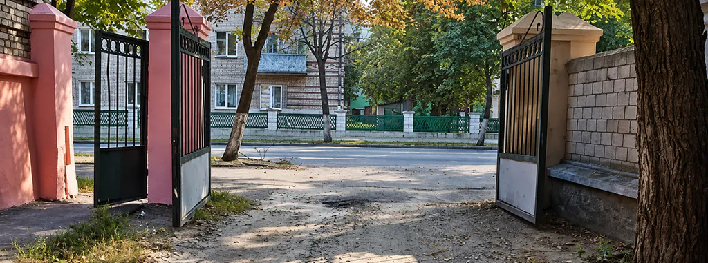

Комплект A/B, билет 26, вопрос 1. Исходная иллюстрация базы приложения, без перерисовки.

A/B, билет 26, вопрос 1. Выезд из двора или с другой прилегающей территории:

- Считается перекрёстком равнозначных дорог
- Считается перекрёстком неравнозначных дорог
- Не считается перекрёстком

Проверить ответ

Верно: Не считается перекрёстком.

На рисунке выезд через ворота дворовой территории. Правильный вариант прямо соответствует определению: он не считается перекрёстком. Поэтому варианты «равнозначных» и «неравнозначных дорог» здесь не подходят ещё до обсуждения очерёдности проезда.

Это полезная первая развилка. Если сразу искать машину справа, можно начать применять правило, рассчитанное на другую ситуацию. Сначала ответьте, что именно изображено, и только затем определяйте обязанность уступить.

### Задача 2. Грунтовое примыкание и городской двор

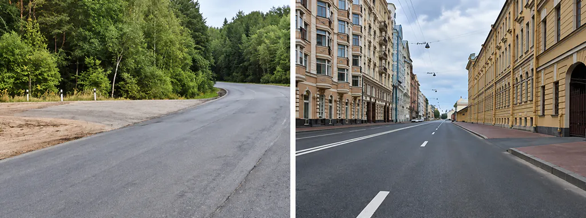

Комплект A/B, билет 30, вопрос 1. Исходная иллюстрация базы приложения, без перерисовки.

A/B, билет 30, вопрос 1. На каком рисунке изображён перекрёсток?

- Только на левом
- Только на правом
- На обоих

Проверить ответ

Верно: Только на левом.

Слева показано примыкание дороги, справа — выезд с прилегающей территории. Верный ответ базы — «Только на левом». Асфальт и городской фон справа не превращают двор в перекрёсток, а грунтовое покрытие слева не лишает примыкание статуса пересечения дорог.

Слова «перекрёсток» и «равнозначный» тоже не являются синонимами. На левом рисунке дороги неравнозначные: различие покрытия участвует в определении главной дороги. Но вопрос здесь просит установить именно наличие перекрёстка, а не всю последовательность проезда воображаемых участников.

При повторении закройте варианты и опишите каждую половину одной фразой. Не запоминайте «левый правильный»: в другой задаче расположение рисунков и содержание вопроса могут быть иными. Ищите основание, а не место ответа на экране.

### Задача 3. Кому уступают при выезде

A/B, билет 32, вопрос 8. Выезжая с прилегающей территории, необходимо уступить дорогу:

- Только маршрутным транспортным средствам
- Всем механическим транспортным средствам
- Транспортным средствам, лицам, использующим для передвижения средства индивидуальной мобильности и пешеходам

Проверить ответ

Верно: Транспортным средствам, лицам, использующим для передвижения средства индивидуальной мобильности и пешеходам.

Пункт 8.3 требует при выезде на дорогу с прилегающей территории уступить транспортным средствам, лицам, использующим СИМ, и пешеходам, движущимся по ней. Поэтому ответ «только маршрутным» слишком узок. Вариант «всем механическим транспортным средствам» тоже не охватывает полный круг участников.

Велосипед — транспортное средство; его нельзя мысленно исключить только потому, что в правильном варианте он не перечислен отдельным словом. И не ограничивайте проверку одним направлением: обязанность связана с движением участников по дороге, а не с тем, кто находится у вас справа.

### Въезд во двор и выезд из него: разные формулировки

| Ваше действие | Что проверяет пункт 8.3 | Дополнительное внимание |
| --- | --- | --- |
| Выезжаете на дорогу | Уступить ТС, пользователям СИМ и пешеходам, движущимся по ней | Не применять вместо этого только «помеху справа» |
| Съезжаете с дороги на прилегающую территорию | Уступить пешеходам, велосипедистам и пользователям СИМ, чей путь пересекаете | Другие обязанности при манёвре продолжают действовать |

Вторая строка не означает, что при повороте налево во двор можно игнорировать встречный транспорт: требования к манёвру рассматриваются совместно. Таблица выделяет две формулировки одного пункта, а не перечисляет все возможные обязанности водителя.

### Почему после двора ограничение может продолжаться

У некоторых запрещающих знаков зона связана с ближайшим перекрёстком. Но в описании их действия прямо указано, что выезд с прилегающей территории не прерывает соответствующую зону. Например, после проезда дворового выезда нельзя автоматически считать отменённым ранее установленное ограничение максимальной скорости.

Проверяйте конкретный знак, табличку и правила его зоны. Не выводите из этого обратное обобщение «никакой знак нигде не заканчивается»: в задаче может быть знак конца ограничения, иной установленный предел или другое предусмотренное условие.

### Упражнение на следующий билет

Составьте короткую запись: объект — моя траектория — кому уступаю — норма. Если объект является прилегающей территорией, назовите признаки из условия. Если перекрёстком — отдельно определите регулируемость и положение дорог. Это помогает не переносить знакомую очерёдность на другую геометрию.

Для следующего шага используйте [общую карту проезда перекрёстков](https://pdd-drive.ru/blog/proezd-perekrestkov-pdd/) и [правила маневрирования](https://pdd-drive.ru/blog/manevrirovanie-pdd/). Здесь главное различие уже найдено: похожее пересечение на рисунке ещё не означает одинаковый правовой статус.

### Частые вопросы

#### Выезд со двора — равнозначный перекрёсток?

Нет. Пункт 1.2 исключает выезды с прилегающих территорий из понятия перекрёстка. При выезде на дорогу применяется пункт 8.3.

#### Грунтовая дорога не считается дорогой на перекрёстке?

Считается. В приведённом вопросе 30–1 слева изображён именно перекрёсток. Покрытие может влиять на приоритет, но само по себе не отменяет статус дороги.

#### При выезде из двора уступают только автомобилям?

Нет. Нужно учитывать транспортные средства, пользователей СИМ и пешеходов, движущихся по дороге. К транспортным средствам относятся и велосипеды.

#### Дворовой выезд отменяет знак ограничения скорости?

Сам по себе выезд с прилегающей территории не прерывает зону действия знака 3.24. Нужно проверить конкретные условия окончания ограничения.

### Источники

- [ПДД РФ, пункт 1.2: определения массы, остановки, стоянки и перекрёстка](https://www.consultant.ru/document/cons_doc_LAW_2709/5894b193fda5648afe1c1a5e70c028f25cd29099/)
- [ПДД РФ, пункты 8.1–8.4: сигналы, въезд и выезд, перестроение](https://www.consultant.ru/document/cons_doc_LAW_2709/2fdfa8559de67744dab415a31c1f987bc016016b/)
- [ПДД РФ, приложение 1: знаки 3.4, 3.11, 3.27 и 3.28](https://www.consultant.ru/document/cons_doc_LAW_2709/bf1f4781b8aa1172e9993c89c36db0dcdc88c495/)

### Практика после статьи

**Определите объект до поиска приоритета**

В новом билете сначала отличите перекрёсток от прилегающей территории, затем объясните обязанность уступить.

[Решать вопросы PDD Drive](https://pdd-drive.ru/app/)

## 4. Знаки или разметка: что главнее при противоречии в билетах ПДД

Выход: 2026-11-23. Проверено: 2026-10-22.

[Исходник с разметкой и ссылками на изображения](../../web_landing/ru/blog/znaki-i-razmetka-chto-glavnee-v-biletah/source.json).

[Обложка](../../web_landing/ru/blog/znaki-i-razmetka-chto-glavnee-v-biletah/cover.jpg).

Если дорожный знак и горизонтальная разметка противоречат друг другу, руководствуются знаком. При противоречии временной и постоянной разметки — временной. Сначала нужно установить само противоречие: знак и линия могут уточнять разные условия и действовать одновременно.

Ниже — три вопроса A/B и способ проверить вывод. Это узкий разбор сочетаний, а не замена справочника всех знаков и линий. Не нужно превращать его в правило «одна стрелка отменяет всё»: каждая норма относится к определённой паре требований.

### Как распознать настоящее противоречие

Сформулируйте действие, которое определяет каждый элемент. Один разрешает или предписывает проезд по данной траектории, другой запрещает её? Тогда возникает несовместимость. Если знак ограничивает скорость, а разметка разделяет полосы, требования обычно можно выполнить вместе: одно не отменяет другое.

Также проверьте, относится ли знак к вашей полосе, направлению или транспортному средству. Нельзя объявить разметку отменённой на всём перекрёстке, увидев знак, который установлен для другого подъезда. Статус таблички и место установки входят в условие задачи.

### Задача 1. Знак против горизонтальной разметки

A/B, билет 19, вопрос 5. Чем необходимо руководствоваться, если значения дорожных знаков и линий горизонтальной разметки противоречат друг другу?

- Требованиями линий разметки
- Требованиями дорожных знаков
- Правила эту ситуацию не регламентируют

Проверить ответ

Верно: Требованиями дорожных знаков.

Вариант «требованиями дорожных знаков» соответствует заключительному правилу раздела о горизонтальной разметке в приложении 2. Оно включает в том числе временные знаки. Наличие линии на асфальте само по себе не даёт ей приоритет перед знаком.

Та же норма говорит о недостаточно различимой разметке. Но не следует делать из неё разрешение игнорировать все видимые линии из-за одного стёртого участка. Нужно определить, какое конкретное требование применяется к вашей ситуации, и соблюдать остальные правила движения.

### Задача 2. Белая и оранжевая линии

A/B, билет 20, вопрос 5. Чем необходимо руководствоваться, если нанесённые на проезжей части белые и оранжевые линии разметки противоречат друг другу?

- Белыми линиями разметки
- Оранжевыми линиями разметки
- Правила эту ситуацию не регламентируют

Проверить ответ

Верно: Оранжевыми линиями разметки.

Для временной горизонтальной разметки ПДД устанавливают оранжевый цвет с оговорёнными в приложении 2 исключениями для отдельных видов линий. Если её линии противоречат постоянным, следовать нужно временным. В этой задаче белая и оранжевая линии прямо названы противоречащими, поэтому выбирается оранжевая.

Не запоминайте сокращение «всё цветное временное». Для постоянной разметки ПДД предусматривают несколько цветов, а жёлтые линии запрета остановки или стоянки не становятся временными только из-за цвета. Сначала определяйте вид разметки и её значение.

Также не путайте временную разметку с изображёнными в учебной картинке стрелками траекторий А и Б. Такие стрелки показывают варианты ответа и сами не являются нанесёнными на дорогу линиями разметки.

### Задача 3. Препятствие и предписанный объезд

Комплект A/B, билет 35, вопрос 5. Исходная иллюстрация базы приложения, без перерисовки.

A/B, билет 35, вопрос 5. Вы можете объехать препятствие:

- Только по траектории А
- Только по траектории Б
- По любой траектории из указанных

Проверить ответ

Верно: Только по траектории А.

Перед препятствием установлен 4.2.2 «Объезд препятствия слева». На схеме этому соответствует траектория А. При решении учитывается приоритет знака над разметкой, поэтому привычка автоматически отвергать любую показанную траекторию через линию здесь приводит к неверному ответу.

Но это не разрешение произвольно объезжать любое препятствие через любую сплошную. В билете есть конкретный знак, предписывающий сторону объезда. Если его убрать, получится другая задача с другими условиями. В реальном манёвре остаются требования безопасности и обязанности перед остальными участниками движения.

### Таблица для трёх разных конфликтов

| Что противоречит | Чем руководствуются | Где искать норму |
| --- | --- | --- |
| Знак и горизонтальная разметка | Дорожным знаком, включая временный | Приложение 2, раздел о горизонтальной разметке |
| Временная и постоянная разметка | Линиями временной разметки | Тот же раздел приложения 2 |
| Временный и стационарный дорожные знаки | Временным знаком | Приложение 1, заключительные положения |

Это попарные правила. Последняя строка не делает любой жёлтый предмет главным: временный знак нужно распознать по предусмотренным признакам. ПДД относят к временным определённые знаки на жёлтом фоне, а также знаки на переносных опорах. Цвет рекламного щита или ограждения не относится к этой классификации.

### Проверка без заучивания ответа

Для новой картинки запишите: «Элемент 1 требует…; элемент 2 требует…; одновременно выполнить можно/нельзя». Только после этого выбирайте нужную строку таблицы. Если требования совместимы, говорить об отмене одного из них преждевременно.

Например, знак направления движения и линия полос могут совместно определять разрешённый манёвр. Разрешённое направление ещё не означает разрешение пересечь любую линию в любом месте. Аналогично знак ограничения скорости и стрелка направления не спорят о приоритете: они отвечают на разные вопросы.

После ответа вернитесь к пояснению и найдите конкретную пару требований. Если объяснение получилось только «знаки всегда главнее», дополните его: над чем, при каком противоречии и для какого направления. Так правило становится применимым к следующему вопросу, а не к одной знакомой иллюстрации.

Для расшифровки линий откройте [справочник дорожной разметки](https://pdd-drive.ru/blog/dorozhnaya-razmetka-2026/), для значения знака — [разбор групп знаков](https://pdd-drive.ru/blog/dorozhnye-znaki-2026/). Затем выберите новый билет в [PDD Drive](https://pdd-drive.ru/app/) и проверьте, можете ли назвать само противоречие до выбора ответа.

### Частые вопросы

#### Что главнее: знак или сплошная разметка?

При противоречии значений дорожного знака и горизонтальной разметки руководствуются знаком. Сначала проверьте, относятся ли оба требования к вашей ситуации и действительно ли они несовместимы.

#### Белая и оранжевая разметка противоречат. Какую выбрать?

Временную оранжевую разметку. Это прямое условие вопроса A/B 20–5 и правило приложения 2 к ПДД.

#### Жёлтая разметка всегда временная?

Нет. Цветная разметка может быть постоянной. Временную горизонтальную разметку нужно отличать по установленным ПДД признакам, а не по противопоставлению «белая — цветная».

#### Любое препятствие разрешает пересечь сплошную?

Нет. В вопросе 35–5 задан конкретный знак объезда слева. Его наличие существенно; переносить ответ на ситуацию без этого знака нельзя.

### Источники

- [ПДД РФ, приложение 2: горизонтальная разметка и противоречия со знаками](https://www.consultant.ru/document/cons_doc_LAW_2709/8b4d779e30a40c4f48df8edd7c7d2e1a12e91d77/)
- [ПДД РФ, приложение 1: предписывающие знаки, в том числе 4.2.2](https://www.consultant.ru/document/cons_doc_LAW_2709/cfcce287ebd89cee09dc5b780337286c556b0978/)
- [ПДД РФ, приложение 1: таблички и правило о временных знаках](https://www.consultant.ru/document/cons_doc_LAW_2709/d507c6724f67c7a6ff27ba125eb7db3e4d36a3a6/)

### Практика после статьи

**Найдите противоречие перед выбором ответа**

Откройте вопрос и сформулируйте отдельно требования знака и линии, затем проверьте их совместимость.

[Открыть практику PDD Drive](https://pdd-drive.ru/app/)

## 5. Почему поворотник не даёт преимущества: три задачи ПДД

Выход: 2026-11-25. Проверено: 2026-10-22.

[Исходник с разметкой и ссылками на изображения](../../web_landing/ru/blog/povorotnik-ne-daet-preimushchestva-pdd/source.json).

[Обложка](../../web_landing/ru/blog/povorotnik-ne-daet-preimushchestva-pdd/cover.jpg).

Включённый указатель поворота сообщает о намерении, но не даёт преимущества и не освобождает от мер предосторожности. Это прямо закреплено в пункте 8.2. Чтобы решить билет, отдельно определите обязанность подать сигнал и обязанность уступить дорогу.

Проверим различие на трёх вопросах A/B: общая норма, перестроение при окончании полосы и выбор момента сигнала перед остановкой за перекрёстком. Подборка учебная; мы не называем эти вопросы самыми частыми или трудными без статистики.

### Сигнал и приоритет отвечают на разные вопросы

| Что нужно установить | О чём говорит | Чего не заменяет |
| --- | --- | --- |
| Сигнал указателем или рукой | О намерении совершить предусмотренный манёвр | Правило, кому уступить |
| Преимущество | О первоочередном движении в заданном направлении | Обязанность предупредить и действовать безопасно |
| Разрешённость манёвра | О возможности выполнить его в данном месте | Ни сигнал, ни сам факт наличия свободного пространства |

Пункт 8.1 требует сигнал перед началом движения, перестроением, поворотом, разворотом и остановкой; при отсутствии или неисправности указателей предусмотрен сигнал рукой. По пункту 8.2 он подаётся заблаговременно и прекращается немедленно после манёвра. При этом нельзя вводить других участников в заблуждение.

### Задача 1. Даёт ли подача сигнала преимущество

A/B, билет 33, вопрос 7. Даёт ли преимущество в движении подача сигнала указателями поворота?

- Дает преимущество
- Дает преимущество только при завершении обгона
- Не дает преимущества

Проверить ответ

Верно: Не дает преимущества.

Верный ответ не содержит исключения «при завершении обгона». Сигнал не меняет очередность сам по себе. Вопрос специально позволяет проверить, не подменяете ли вы намерение правом требовать свободную полосу.

Не делайте и обратный вывод, будто указатели необязательны. Отсутствие преимущества от сигнала не отменяет обязанность предупредить. Две проверки выполняются вместе: нужен ли сигнал и можно ли безопасно осуществить манёвр по остальным требованиям.

### Задача 2. Полоса заканчивается, поворотник включён

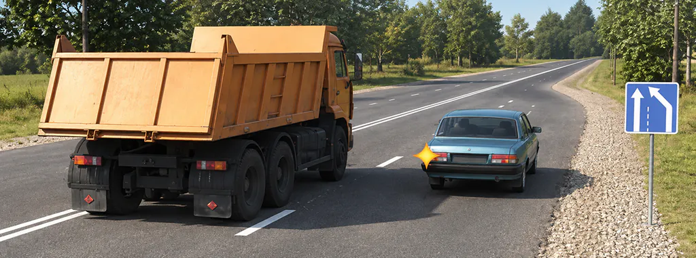

Комплект A/B, билет 4, вопрос 8. Исходная иллюстрация базы приложения, без перерисовки.

A/B, билет 4, вопрос 8. Кто должен уступить дорогу?

- Водитель грузового автомобиля
- Водитель легкового автомобиля

Проверить ответ

Верно: Водитель легкового автомобиля.

У легкового автомобиля заканчивается полоса, слева грузовик движется попутно без изменения направления. Водителю легкового нужно перестроиться, а по пункту 8.4 при перестроении уступают попутному транспорту, который продолжает движение по своей полосе. Поэтому правильный вариант — «Водитель легкового автомобиля».

Включённый левый указатель и знак конца полосы объясняют намерение и организацию движения. Они не превращают перестроение в обязательное предоставление места со стороны грузовика. Сначала определите, кто меняет полосу, затем примените соответствующую часть нормы.

Не смешивайте эту картинку с одновременным перестроением. Там нужно отдельно установить, что перестраиваются оба попутных транспортных средства, и применить правило о находящемся справа. Вопрос 4–8 изображает другую исходную ситуацию: один водитель уходит с заканчивающейся полосы.

### Задача 3. Сигнал можно подать слишком рано

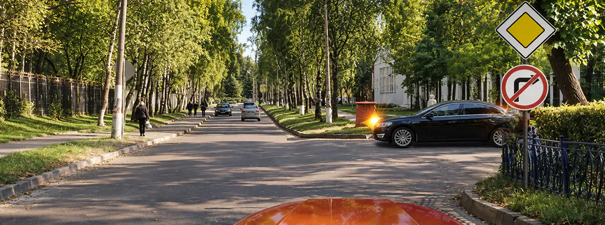

Комплект A/B, билет 38, вопрос 7. Исходная иллюстрация базы приложения, без перерисовки.

A/B, билет 38, вопрос 7. Вы намерены остановиться сразу за перекрестком. В каком месте необходимо включить указатели правого поворота?

- До въезда на перекрёсток, чтобы заблаговременно предупредить других водителей об остановке
- Только после въезда на перекрёсток
- Место включения указателей поворота не имеет значения, так как поворот направо запрещён

Проверить ответ

Верно: Только после въезда на перекрёсток.

Вы хотите остановиться сразу за перекрёстком. Если подать правый сигнал до въезда, другой водитель может понять его как намерение повернуть на перекрёстке. Поэтому правильный вариант базы — «Только после въезда на перекрёсток».

Смысл не в механическом правиле «включай в середине». Важно выбрать такой момент, который заблаговременно предупреждает о действительном действии и не вводит в заблуждение. Пояснение базы дополнительно уточняет, что включение сразу в начальной фазе въезда тоже может быть понято как запоздавшее сообщение о повороте.

Знак запрета правого поворота в рисунке не делает сигнал перед остановкой бессмысленным: сигнал нужен для намерения остановиться. Поэтому третий вариант, который объявляет место подачи неважным, неверен. Отделяйте конкретный манёвр от похожего значения того же указателя.

### Что означает «заблаговременно» для решения билета

В приведённом пункте 8.2 нет универсального числа секунд для любых условий. Задача может проверять место включения, отсутствие заблуждения или окончание подачи после манёвра. Не добавляйте в ответ запомнённый из чужого совета числовой интервал, если его не задаёт правило или условие.

Особенно внимательно читайте соседние съезды и пересечения: слишком ранний сигнал способен сообщить не тот поворот, который вы задумали. Но это не повод подавать сигнал уже после начала действия. В учебном разборе нужно совместить оба требования, а не выбрать одно за счёт другого.

### Упражнение: две отдельные строки

Для новой задачи напишите: «Какой сигнал и для какого действия?» и «По какой норме определяется, кому уступить?». В примере с окончанием полосы первая строка относится к левому перестроению, вторая — к пункту 8.4. В примере с остановкой за перекрёстком предмет проверки — понятный момент подачи сигнала.

Если ответ свёлся к «он моргает, значит, его надо пустить», вернитесь к пункту 8.2 и восстановите недостающую норму приоритета. Если вы решили, что имеющееся преимущество позволяет не предупреждать о повороте, повторите пункт 8.1. Эти два сокращения ведут к разным ошибкам.

Дополнительные условия манёвров собраны в [разборе перестроения, поворотов и разворотов](https://pdd-drive.ru/blog/manevrirovanie-pdd/). В [PDD Drive](https://pdd-drive.ru/app/) откройте новый билет своей категории и объясните обе строки до просмотра комментария. Проверяемое понимание здесь полезнее узнавания одного светящегося указателя на картинке.

### Частые вопросы

#### Обязан ли другой водитель пустить меня после включения поворотника?

Сам по себе сигнал не создаёт такой обязанности. Очерёдность определяется соответствующими правилами, например пунктом 8.4 при перестроении.

#### Если полоса заканчивается, у перестраивающегося появляется преимущество?

В приведённом вопросе нет. Водитель легкового автомобиля уступает попутному грузовику, который продолжает движение по своей полосе.

#### За сколько секунд включать указатель поворота?

Пункт 8.2 требует заблаговременную подачу без введения других участников в заблуждение, но не задаёт одно универсальное число секунд для любых условий.

#### Нужно ли подавать сигнал, если у меня есть преимущество?

Наличие преимущества не отменяет обязанность предупредить о предусмотренном манёвре и принять меры предосторожности.

### Источники

- [ПДД РФ, пункты 8.1–8.4: сигналы, въезд и выезд, перестроение](https://www.consultant.ru/document/cons_doc_LAW_2709/2fdfa8559de67744dab415a31c1f987bc016016b/)
- [ПДД РФ, пункт 1.2: определения массы, остановки, стоянки и перекрёстка](https://www.consultant.ru/document/cons_doc_LAW_2709/5894b193fda5648afe1c1a5e70c028f25cd29099/)

### Практика после статьи

**Проверьте сигнал и обязанность уступить отдельно**

В новом вопросе сначала определите манёвр, затем основание приоритета. Выберите свой комплект A/B или C/D.

[Открыть практику PDD Drive](https://pdd-drive.ru/app/)

## 6. Вопросы ПДД со словом «не»: как прочитать условие и выбрать нужный ответ

Выход: 2026-11-27. Проверено: 2026-10-22.

[Исходник с разметкой и ссылками на изображения](../../web_landing/ru/blog/voprosy-pdd-so-slovom-ne/source.json).

[Обложка](../../web_landing/ru/blog/voprosy-pdd-so-slovom-ne/cover.jpg).

Вопрос «Кто не нарушил?» требует выбрать водителей, действующих по правилам. Вопрос «Кто нарушил?» — другую группу. Если пропустить частицу, можно правильно оценить ситуацию и всё равно нажать неверный вариант. Помогает простая последовательность: сначала определить, что требуется найти, затем разобрать рисунок и только после этого сравнить ответы.

Ниже три реальных задания комплекта A/B. Мы выбрали их для упражнения на чтение; это не рейтинг ошибок учеников. Тексты и варианты приведены из базы приложения, объяснения после ответов помогают связать формулировку с правилом. Сначала решите каждый вопрос самостоятельно.

### Четыре действия перед выбором ответа

- Прочитайте последнюю часть вопроса. Нужно найти нарушителей, разрешённые направления или отсутствие обязанности? Назовите задачу своими словами: «выбираю тех, кто остановился правильно».
- Сохраните условия. Не удаляйте при пересказе слова «только», «более», «не более», указание массы и направления движения. Они определяют область применения правила.
- Оцените каждый объект отдельно. Сначала автомобиль А, затем Б и В. Объединение вроде «А и Б» выбирайте после проверки обоих, а не по знакомому расположению варианта.
- Сверьте ответ с исходным вопросом. Закончили рассуждение словом «нарушил»? Убедитесь, что именно это у вас спрашивали. Такая проверка занимает меньше времени, чем повторное решение всего рисунка.

### Пример 1: «не нарушает» не означает «груз не выступает»

#### A/B, билет 7, вопрос 17

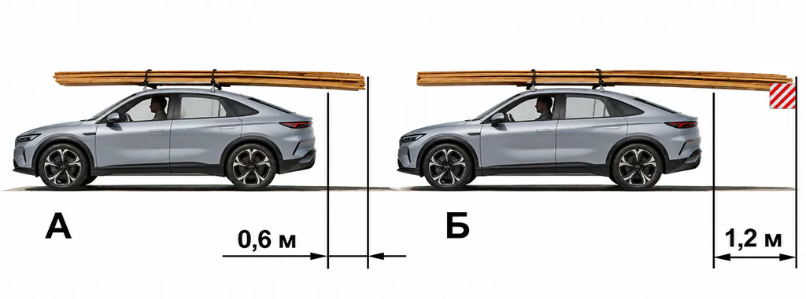

A/B, билет 7, вопрос 17. Иллюстрация из базы приложения.

На каком рисунке изображён автомобиль, водитель которого не нарушает правил перевозки грузов?

- Только на А
- Только на Б
- На обоих

Показать ответ и разбор

Ответ 3: На обоих. На А груз выступает на 0,6 м. На Б выступание составляет 1,2 м и обозначено знаком. В показанных условиях оба водителя соблюдают требование п. 23.4; вопрос просит найти именно тех, кто не нарушает.

Полезно разделить два утверждения: «груз выступает» и «правила нарушены». Первое ещё не доказывает второе. На рисунке Б нужен и присутствует опознавательный знак. Если запомнить только внешний вид длинных досок, можно выбрать автомобиль А и пропустить законно обозначенный выступающий груз.

### Пример 2: отсутствие обязанности уступать зависит от сигнала

#### A/B, билет 13, вопрос 13

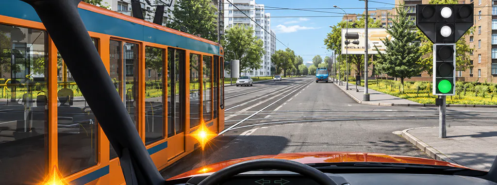

A/B, билет 13, вопрос 13. Иллюстрация из базы приложения.

В данной ситуации Вы не обязаны уступать дорогу трамваю при движении:

- Прямо или направо
- Только прямо
- Только направо

Показать ответ и разбор

Ответ 1: Прямо или направо. Автомобилю горит зелёный. Бело-лунный светофор разрешает трамваю движение прямо, но трамвай намерен повернуть направо и должен дождаться разрешения своего направления. По пп. 6.2 и 6.8 при движении автомобиля прямо или направо уступать этому трамваю не требуется.

Здесь нельзя заменить вопрос другим: «Есть ли у трамвая преимущество вообще?» Проверяется его движение по конкретному сигналу и заданному направлению. После ответа мысленно уберите частицу «не» из условия: заметили, что пришлось бы искать уже другую ситуацию? Менять настоящий вопрос при решении, конечно, не нужно — это отдельное учебное упражнение.

### Пример 3: проверяем всех, кто остановился правильно

#### A/B, билет 35, вопрос 12

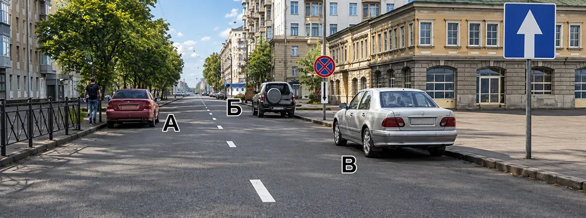

A/B, билет 35, вопрос 12. Иллюстрация из базы приложения.

Водители каких автомобилей не нарушили правила остановки?

- Только автомобиля Б
- Только автомобиля В
- Автомобилей А и Б
- Автомобилей А и В

Показать ответ и разбор

Ответ 3: Автомобилей А и Б. В населённом пункте на этой дороге с односторонним движением легковой автомобиль А может остановиться слева по п. 12.1. Б находится за концом запретной зоны. В стоит перед знаком с табличкой 8.2.3 и находится внутри зоны запрета. Подходят А и Б.

В этом задании полезна короткая запись: «А — разрешено; Б — разрешено; В — запрещено». Затем сопоставьте запись с вариантами. Так вы отделяете применение ПДД от чтения отрицательной формулировки и видите, на каком этапе возникла ошибка.

### Три похожих выражения с разным смыслом

| Формулировка | Что проверить |
| --- | --- |
| Не нарушили | Кто выполнил применимые требования |
| Не обязаны уступать | Есть ли обязанность уступить в заданном направлении и условии |
| Не более 3,5 т | Значение до границы включительно; это не отрицание разрешения |

Универсальное правило «увидел “не” — выбирай противоположное» не работает. В выражении «не более» частица задаёт числовую границу. А слова «не обязаны уступать» не разрешают нарушать сигналы, разметку или требования безопасности. Прочитайте целое словосочетание, а не отдельный символ.

### Как закрепить навык после трёх задач

В следующем занятии найдите несколько вопросов с отрицанием в своём комплекте. Перед каждым ответом произнесите, кого или что вы ищете. Если ошиблись, запишите две вещи: верно ли определили правило и верно ли поняли требуемую группу. «Знал знак, но выбрал нарушителя вместо ненарушителя» требует другой работы, чем незнание самого знака.

Не нужно намеренно замедлять каждый знакомый вопрос до бесконечности. Цель упражнения — сделать проверку смысла привычной, а затем сохранить её в полном экзамене с таймером. Дополнительные способы повторения собраны в [плане изучения билетов](https://pdd-drive.ru/blog/kak-bystro-vyuchit-bilety-pdd/); к точным правилам возвращайтесь через справочник.

### Частые вопросы

#### Нужно ли всегда искать отрицание в вариантах?

Нет. Сначала определите задачу вопроса. Верный вариант может быть коротким «На обоих» и вообще не содержать отрицания.

#### Что означает «не более 3,5 т»?

Граница 3,5 т включена. Не заменяйте её словами «менее 3,5 т» или «более 3,5 т»: это другие условия.

#### Можно ли научиться этому только на одном билете?

Один билет помогает увидеть приём. Для проверки навыка нужны другие вопросы и повторение после перерыва, когда готовый ответ уже не подсказывает выбор.

### Источники

- [ПДД, п. 23.4: обозначение выступающего груза](https://www.consultant.ru/document/cons_doc_LAW_2709/9f6f60efaee3994438e38b50a90595abfaaaf5a2/)
- [ПДД, пп. 6.2 и 6.8: автомобильный и бело-лунный светофоры](https://www.consultant.ru/document/cons_doc_LAW_2709/4b7a10a56ed37080fc96999db5f3db6f3aa58cc6/)
- [ПДД, п. 12.1: сторона остановки и стоянки](https://www.consultant.ru/document/cons_doc_LAW_2709/59ded54942baa2143676e12b31244b0cb7ada00d/)
- [Госавтоинспекция: экзаменационные билеты A/B](https://гибдд.рф/mens/avtovladeltsam/abm)

### Практика после статьи

**Закрепите чтение условия на разных темах**

Откройте билеты A/B. Перед ответом назовите, что требуется найти, а после ошибки сравните свою формулировку с исходной.

[Открыть билеты](https://pdd-drive.ru/app/)

## 7. Тормозной и остановочный путь в билетах ПДД: три вопроса без путаницы

Выход: 2026-11-30. Проверено: 2026-10-22.

[Исходник с разметкой и ссылками на изображения](../../web_landing/ru/blog/tormoznoy-i-ostanovochnyy-put-v-biletah/source.json).

[Обложка](../../web_landing/ru/blog/tormoznoy-i-ostanovochnyy-put-v-biletah/cover.jpg).

Остановочный путь начинается в момент обнаружения опасности, а не в момент нажатия на тормоз. Пока водитель распознаёт ситуацию и начинает действовать, автомобиль уже проходит расстояние. Именно поэтому в вопросах нельзя подменять весь путь остановки только торможением.

Разберём три текстовых задания A/B: определение, путь за время реакции и зависимость от скорости. В исходных вопросах нет рисунков. Схема ниже создана для объяснения этапов и не является иллюстрацией официального билета. Числа в учебной задаче не дают готового безопасного расстояния для любой дороги.

### Сначала определите начало и конец отсчёта

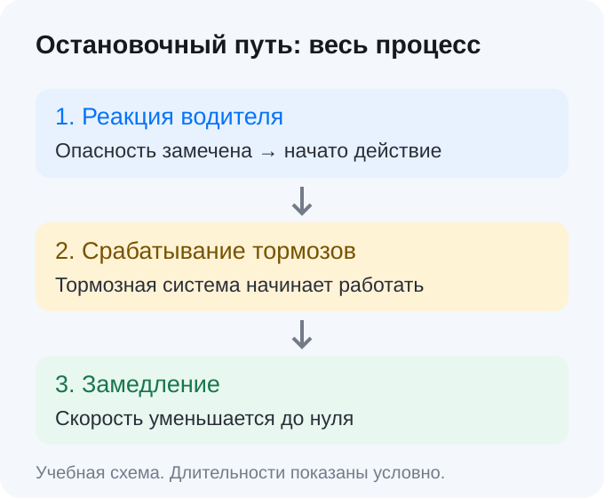

Учебная схема этапов. Длины блоков не изображают реальные расстояния или длительности.

Весь остановочный путь включает движение во время реакции, срабатывания тормозной системы и последующего замедления до нуля. Вопрос о тормозном пути относится к торможению, поэтому его зависимость нельзя автоматически переносить на весь процесс. При разборе варианта ответа отмечайте, с какого события автор начинает измерять расстояние.

### Задача 1: где начинается остановочный путь

#### A/B, билет 39, вопрос 20

Что понимается под остановочным путем?

- Расстояние, пройденное транспортным средством с момента обнаружения водителем опасности до полной остановки
- Расстояние, пройденное транспортным средством с момента нажатия на педаль тормоза до полной остановки
- Расстояние, пройденное транспортным средством с момента начала срабатывания тормозного привода до полной остановки

Показать ответ и разбор

Ответ 1: Расстояние, пройденное транспортным средством с момента обнаружения водителем опасности до полной остановки. Из предложенных начал отсчёта подходит обнаружение опасности. Весь остановочный путь учитывает и движение до фактического замедления автомобиля; два других варианта начинают измерение позднее.

Варианты похожи окончанием «до полной остановки». Различие спрятано в начале: обнаружение опасности, нажатие педали или срабатывание привода. Если прочитать только последние слова, все ответы покажутся равными. Для самопроверки мысленно поставьте три отметки на линии времени и найдите самую раннюю.

### Задача 2: автомобиль движется и до начала торможения

#### A/B, билет 11, вопрос 20

Какое расстояние проедет транспортное средство за время, равное среднему времени реакции водителя, при скорости движения около 90 км/час?

- Примерно 15 м
- Примерно 25 м
- Примерно 35 м

Показать ответ и разбор

Ответ 2: Примерно 25 м. Около 90 км/ч соответствует примерно 25 м/с. При принятом в этом вопросе среднем времени реакции около секунды получается примерно 25 м.

Здесь достаточно перевести единицы: 90 км/ч — это 90 000 метров за 3 600 секунд, то есть 25 м/с. Вопрос использует принятое в билетах среднее время реакции около одной секунды. За эту секунду автомобиль проходит примерно 25 метров, ещё до завершения всего процесса остановки.

Это расчёт для условия задачи, а не обещание, что любой человек всегда реагирует ровно за секунду. Если в другом упражнении указано другое время, расстояние за реакцию при той же скорости меняется вместе с ним. Привычка искать готовую цифру «25» без чтения скорости приводит к ошибке.

### Задача 3: скорость и квадрат скорости

#### A/B, билет 25, вопрос 19

Как зависит величина тормозного пути транспортного средства от скорости движения?

- Не зависит
- Увеличивается пропорционально скорости
- Увеличивается пропорционально квадрату скорости

Показать ответ и разбор

Ответ 3: Увеличивается пропорционально квадрату скорости. В учебном сравнении при одинаковых остальных условиях тормозной путь зависит от квадрата скорости: увеличение скорости в два раза даёт увеличение пути в четыре раза. Вопрос относится к тормозному, а не ко всему остановочному пути.

Ключевое ограничение объяснения — сопоставимые условия торможения. При одинаковых прочих условиях удвоение скорости увеличивает тормозной путь примерно в четыре раза. Это не означает, что весь остановочный путь обязательно станет ровно в четыре раза больше: пройденное за одинаковое время реакции расстояние растёт пропорционально скорости.

### Почему «вдвое быстрее — вдвое дальше» здесь не подходит

| Что сравниваем | Если скорость удвоена, прочее одинаково |
| --- | --- |
| Путь за одинаковое время реакции | Удваивается |
| Тормозной путь в учебном сравнении | Увеличивается в четыре раза |
| Полный остановочный путь | Нужно учитывать все его составляющие |

Не складывайте секунды с метрами. Сначала переведите скорость в метры в секунду и умножьте её на время реакции, если задача требует именно это расстояние. Тормозной путь нельзя получить из одной скорости без дополнительных предпосылок: покрытие, состояние автомобиля и условия торможения имеют значение.

Также не подменяйте остановочный путь дистанцией до впереди идущего автомобиля. В первой величине конечная точка — полная остановка вашей машины; вторая описывает расположение двух транспортных средств. В билетах могут встречаться обе темы, но один заученный ответ не решает их вместе.

### Как тренироваться без заучивания чисел

- Назовите измеряемую величину: время реакции, путь реакции, тормозной или остановочный путь.
- Отметьте событие начала отсчёта и конечное состояние. Выпишите единицы: секунды, метры или км/ч.
- Разберите пример с другой скоростью. При 36 км/ч автомобиль проходит 10 метров за секунду, при 72 км/ч — 20. Это иллюстрация перевода единиц, не новый норматив дистанции.
- После перерыва вернитесь к определению. Если помните число, но не можете сказать, что оно измеряет, повторите рассуждение.

В реальном движении важнее не расчёт по памяти, а скорость, соответствующая дорожным условиям. Пункт 10.1 требует учитывать в том числе видимость и при обнаружимой опасности принимать меры к снижению скорости вплоть до остановки. Общий разбор выбора скорости есть в [справочнике скоростных режимов](https://pdd-drive.ru/blog/skorostnye-rezhimy-pdd/); здесь мы учились различать величины в вопросах.

### Частые вопросы

#### Остановочный путь — это расстояние после нажатия тормоза?

Нет. Он отсчитывается от обнаружения водителем опасности до полной остановки и включает движение до начала торможения.

#### Среднее время реакции в билете равно нормативу для каждого водителя?

Нет. Около секунды используется как учебное среднее в соответствующих заданиях. Реальная ситуация и заданное в конкретной задаче время могут отличаться.

#### Можно ли по этим примерам рассчитать безопасную дистанцию на любой дороге?

Нет. Это упражнения на определения и зависимости. Они не учитывают все условия конкретного автомобиля и дороги и не заменяют требования ПДД к выбору скорости и дистанции.

### Источники

- [ПДД, п. 10.1: выбор скорости и действия при опасности](https://www.consultant.ru/document/cons_doc_LAW_2709/803907f6876a655f77995888208488d4bfccf247/)
- [Госавтоинспекция: экзаменационные билеты A/B](https://гибдд.рф/mens/avtovladeltsam/abm)

### Практика после статьи

**Проверьте, какую величину спрашивает билет**

Откройте тему безопасности движения. Перед каждым ответом отметьте начало отсчёта и единицы измерения.

[Открыть темы подготовки](https://pdd-drive.ru/app/)

## 8. 5 и 15 метров в билетах ПДД: где остановиться у перехода и остановки

Выход: 2026-12-02. Проверено: 2026-10-22.

[Исходник с разметкой и ссылками на изображения](../../web_landing/ru/blog/rasstoyaniya-v-biletah-pdd-perehod-ostanovka/source.json).

[Обложка](../../web_landing/ru/blog/rasstoyaniya-v-biletah-pdd-perehod-ostanovka/cover.jpg).

У пешеходного перехода правило говорит о запрете остановки на переходе и ближе пяти метров перед ним. У места остановки маршрутного транспорта действует другое расстояние — пятнадцать метров и специальное исключение для посадки и высадки. Чтобы решить билет, мало запомнить числа: нужно определить объект, точку отсчёта и действие водителя.

Эта статья разбирает только две ситуации из пункта 12.4. Здесь нет общего списка всех расстояний ПДД. Для остальных ограничений используйте [разбор остановки и стоянки](https://pdd-drive.ru/blog/ostanovka-i-stoyanka-pdd/). Три задания ниже взяты из комплекта A/B; сначала рассмотрите рисунок, затем откройте объяснение.

### Две строки, которые нельзя менять местами

| Что находится рядом | Какое правило проверяем | На что смотреть в билете |
| --- | --- | --- |
| Пешеходный переход | Остановка запрещена на переходе и ближе 5 м перед ним | Где ближайшая граница перехода и куда направлен автомобиль |
| Остановка маршрутных ТС | Остановка запрещена ближе 15 м от обозначенного места; при отсутствии разметки отсчёт от указателя | Есть ли разметка, что требуется: стоянка или высадка, создаётся ли помеха |

Слова «перед ним» относятся к направлению движения и переходу. Не превращайте их в симметричное правило «пять метров в любую сторону от любого знака». Для остановки маршрутного транспорта тоже нельзя без проверки измерять расстояние от фонаря, павильона или автобуса: в норме указаны разметка и, при её отсутствии, соответствующий указатель.

### Задача 1: пятнадцать метров от указателя

#### A/B, билет 23, вопрос 12

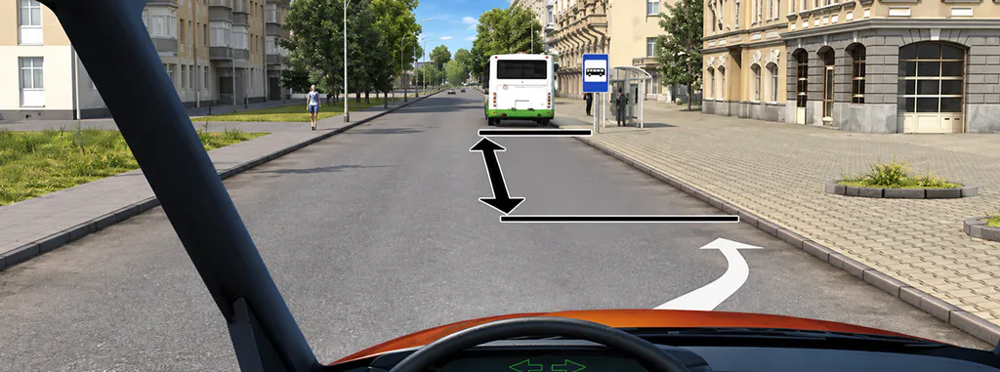

A/B, билет 23, вопрос 12. Иллюстрация из базы приложения.

На каком расстоянии от знака Вам разрешено поставить автомобиль на стоянку?

- Не менее 5 м
- Не менее 10 м
- Не менее 15 м

Показать ответ и разбор

Ответ 3: Не менее 15 м. Для стоянки в показанном месте нужно не менее 15 м от указателя, поскольку разметки остановочного места нет. Запрет остановки действует и для стоянки по п. 12.5. Исключение для посадки и высадки не относится к заданной стоянке.

На рисунке нет разметки остановочного места. Поэтому в этом вопросе расстояние связывается с указателем остановки. Варианты 5 и 10 метров не подходят. Двигатель, работающий во время ожидания, не превратил бы стоянку в разрешённое действие: в условии прямо спрашивается постановка на стоянку.

### Задача 2: на рисунке написано «5 м», но остановка запрещена

#### A/B, билет 25, вопрос 12

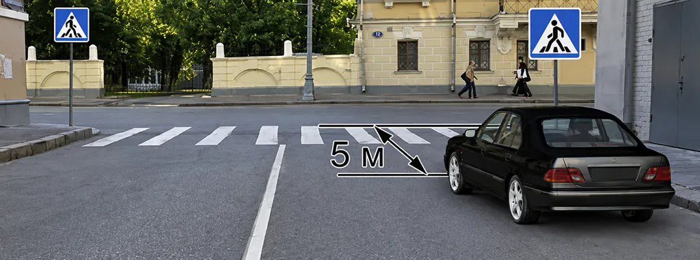

A/B, билет 25, вопрос 12. Иллюстрация из базы приложения.

Разрешена ли остановка в этом месте?

- Разрешена
- Разрешена, если расстояние между транспортным средством и сплошной линией разметки не менее 3 м
- Запрещена

Показать ответ и разбор

Ответ 3: Запрещена. Необходимое расстояние перед переходом не выдержано: 5 м отложены до дальнего от автомобиля края перехода, а ближайший край расположен ближе. Проверять нужно расстояние до ближайшей границы, поэтому сама отметка 5 м ещё не разрешает остановку. Соблюдение расстояния до сплошной линии не устраняет отдельное нарушение п. 12.4.

Размерная линия — часть условия, а не готовый ответ. Здесь она идёт до дальнего от машины края перехода. Найдите оба её конца и ближайшую к автомобилю границу: расстояние до неё меньше указанного. Само число «5» ещё не показывает, что между машиной и этой границей есть необходимые пять метров. Проверка расстояния до сплошной линии также не отменяет запрет возле перехода: соблюдать нужно все применимые ограничения.

Полезный приём: сначала закройте варианты и закончите фразу «пять метров от ... до ...». Если не можете назвать обе точки, вы ещё не прочитали рисунок. Для подобных заданий это надёжнее, чем выбирать ответ по одной крупной цифре на картинке.

### Задача 3: высадка пассажира и условие отсутствия помех

#### A/B, билет 36, вопрос 12

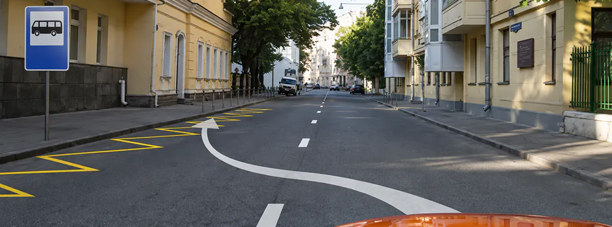

A/B, билет 36, вопрос 12. Иллюстрация из базы приложения.

Разрешена ли Вам остановка для высадки пассажиров в указанном месте?

- Разрешена
- Разрешена, если при этом не будут созданы помехи для движения маршрутных транспортных средств
- Запрещена

Показать ответ и разбор

Ответ 2: Разрешена, если при этом не будут созданы помехи для движения маршрутных транспортных средств. В показанных условиях п. 12.1 допускает остановку слева. Для высадки пассажиров у остановки маршрутного транспорта действует исключение из п. 12.4, только если не создаётся помех движению маршрутных транспортных средств. Поэтому нужен второй, условный вариант.

Здесь вопрос не про ожидание знакомого и не про разгрузку вещей: цель остановки — высадка пассажиров. Для этого случая пункт 12.4 предусматривает исключение при отсутствии помех маршрутному транспорту. На рисунке нужно также учитывать допустимую сторону остановки по п. 12.1. Верный вариант сохраняет условие, а не даёт безусловное разрешение.

### Почему «я на минуту» не заменяет исключение

Продолжительность сама по себе не разрешает остановку в запрещённом месте. В рассматриваемом исключении важны назначение действия и отсутствие помех. Если водитель просто ждёт пассажира, нельзя автоматически объявлять всё ожидание «посадкой». Разберите фактическое условие задания, прежде чем применять исключение.

Не переносите это исключение на пешеходный переход. Разрешение для высадки у остановочного места не отменяет самостоятельный запрет остановки на переходе и ближе пяти метров перед ним. Если на одном рисунке есть оба объекта, выполнение одного расстояния не означает выполнения второго.

### Короткий порядок решения нового рисунка

- Определите действие. Спрашивают остановку, стоянку, посадку или высадку? Не меняйте его мысленно на более удобное.
- Найдите объект ограничения. Переход или место остановки? Если их несколько, проверьте каждый.
- Найдите обозначение и границы. Для остановки посмотрите разметку; если её нет, указатель. Для перехода не спутайте ближайший и дальний край.
- Примените условие целиком. Число, направление отсчёта и исключение должны соответствовать одному правилу.
- Проверьте остальные ограничения. Разрешённое расстояние не отменяет знаки, разметку и требования к стороне дороги.

После разбора запишите не «перепутал 5 и 15», а точную причину: выбрал число для другого объекта, неверно прочитал размерную линию или распространил исключение на ожидание. Затем решите другой вопрос по этой теме. Так вы проверите перенос правила на новый рисунок, а не только память на разобранную сцену.

### Частые вопросы

#### После перехода тоже всегда нужно пять метров?

В этом запрете п. 12.4 сказано «перед ними». Это не отменяет других требований к выбранному месту: знаков, расстояний до иных объектов и запрета создавать помехи.

#### У автобусной остановки всегда отсчитывать от знака?

Нет. Норма сначала указывает обозначенное разметкой место; от указателя отсчитывают при отсутствии такой разметки. Важно прочитать конкретный рисунок.

#### Можно ждать пассажира в зоне остановки, если автобус ещё не приехал?

Не считайте ожидание автоматически разрешённой посадкой или высадкой. Исключение привязано к этим действиям и к отсутствию помех; обычное ожидание им не подменяется.

### Источники

- [ПДД, пп. 12.1, 12.4 и 12.5: сторона, расстояния и исключение для посадки/высадки](https://www.consultant.ru/document/cons_doc_LAW_2709/59ded54942baa2143676e12b31244b0cb7ada00d/)
- [ПДД, приложение 2: разметка пешеходных переходов и остановок](https://www.consultant.ru/document/cons_doc_LAW_2709/8b4d779e30a40c4f48df8edd7c7d2e1a12e91d77/)
- [Госавтоинспекция: экзаменационные билеты A/B](https://гибдд.рф/mens/avtovladeltsam/abm)

### Практика после статьи

**Проверьте точки отсчёта на других рисунках**

Откройте тему остановки и стоянки. Для каждого расстояния назовите, между какими объектами оно измеряется.

[Открыть тренировку по темам](https://pdd-drive.ru/app/)

## 9. Недостаточная и ограниченная видимость: как различать их в билетах ПДД

Выход: 2026-12-04. Проверено: 2026-10-22.

[Исходник с разметкой и ссылками на изображения](../../web_landing/ru/blog/nedostatochnaya-i-ogranichennaya-vidimost-pdd/source.json).

[Обложка](../../web_landing/ru/blog/nedostatochnaya-i-ogranichennaya-vidimost-pdd/cover.jpg).

Недостаточная видимость связана с туманом, дождём, снегопадом и подобными условиями, а также сумерками. Ограниченная — с рельефом, поворотом дороги, растительностью, строениями или другими объектами, которые закрывают обзор. В билетах эти слова не взаимозаменяемы: сначала определите причину, затем применяйте соответствующее требование.

Ниже два вопроса на термины и один на световые приборы из комплекта A/B. Все три в исходной базе текстовые. Авторская схема нужна для сравнения причин; она не изображает дополнительные официальные категории видимости и не заменяет формулировки пункта 1.2.

### Плохая видимость — описание ситуации, термин — точное условие

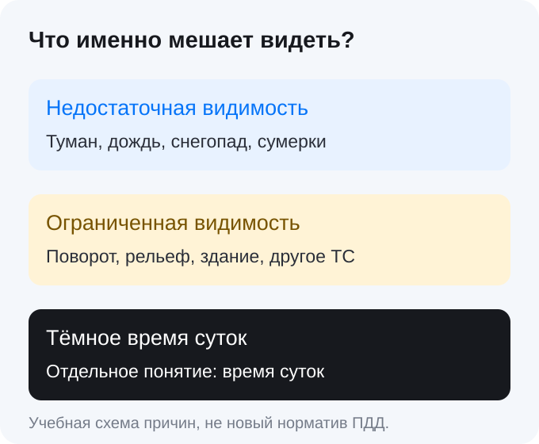

Учебное сравнение. На дороге несколько условий могут встречаться одновременно.

| Понятие | Определяющий признак | Чего не следует добавлять от себя |
| --- | --- | --- |
| Недостаточная видимость | Менее 300 м в перечисленных погодных условиях, а также сумерки | Любую невидимую дорогу за любым предметом |
| Ограниченная видимость | Обзор ограничивают объекты, рельеф или геометрия дороги | Универсальную границу 300 м из другого определения |
| Тёмное время суток | Самостоятельное понятие, связанное со временем суток | Правило «ночью всегда недостаточная видимость» |

Например, ясным днём участок за зданием может быть скрыт. Это не становится туманом из-за того, что водитель видит недалеко. И наоборот: на совершенно прямой дороге туман способен резко ухудшить видимость без единого здания. Сначала ответьте на вопрос «почему не видно?», а не ищите знакомую цифру.

### Задача 1: объект, рельеф и геометрия дороги

#### A/B, билет 14, вопрос 1

Что означает термин «Ограниченная видимость»?

- Видимость водителем дороги, ограниченная рельефом местности, геометрическими параметрами дороги, растительностью, строениями, сооружениями или другими объектами
- Видимость водителем дороги менее 300 м в условиях тумана, дождя, снегопада, а также в сумерки
- Видимость водителем дороги менее 150 м в ночное время
- Видимость водителем дороги во всех перечисленных случаях

Показать ответ и разбор

Ответ 1: Видимость водителем дороги, ограниченная рельефом местности, геометрическими параметрами дороги, растительностью, строениями, сооружениями или другими объектами. Ключ — дорогу закрывают особенности местности, её геометрия или объекты. Определение п. 1.2 не подменяется границей 300 м в тумане и не включает автоматически все перечисленные варианты.

Обратите внимание: в верном варианте нет заданной границы 100, 150 или 300 метров. Варианты с цифрами выглядят конкретнее, но конкретность не делает их определением нужного термина. Числа из других требований нельзя вставлять в понятие по памяти.

### Задача 2: менее трёхсот метров и сумерки

#### A/B, билет 35, вопрос 1

Что означает термин «Недостаточная видимость»?

- Видимость дороги менее 100 м вблизи опасных поворотов и переломов продольного профиля дороги
- Видимость дороги менее 150 м в ночное время
- Видимость дороги менее 300 м в условиях тумана, дождя, снегопада и т. п., а также в сумерки

Показать ответ и разбор

Ответ 3: Видимость дороги менее 300 м в условиях тумана, дождя, снегопада и т. п., а также в сумерки. Верный вариант воспроизводит определение недостаточной видимости: менее 300 м в тумане, дожде, снегопаде и подобных условиях, а также в сумерки. Поворот дороги и произвольная ночная граница относятся к неверным вариантам.

Слово «менее» важно: не заменяйте его на «до 300 включительно». При этом не отбрасывайте заключительную часть определения про сумерки. Вариант о повороте с границей 100 метров описывает другую конструкцию и не отвечает на поставленный вопрос, хотя тоже касается обзора дороги.

### Задача 3: почему одних противотуманных фар недостаточно

#### A/B, билет 10, вопрос 17

При движении в условиях недостаточной видимости можно использовать противотуманные фары:

- Только отдельно от ближнего или дальнего света фар
- Только совместно с ближним или дальним светом фар
- Как отдельно, так и совместно с ближним или дальним светом фар

Показать ответ и разбор

Ответ 2: Только совместно с ближним или дальним светом фар. По п. 19.4 в условиях недостаточной видимости противотуманные фары используют с ближним или дальним светом. Отдельное включение не соответствует этому условию. Требования п. 19.2 к переключению дальнего света также сохраняются.

Разрешение использовать противотуманные фары вместо ближнего света в одном режиме движения не означает такого разрешения при любых условиях. Для недостаточной видимости пункт 19.4 прямо связывает их с ближним или дальним светом. Выбор между ближним и дальним дополнительно ограничивается требованиями о недопущении ослепления.

### Три проверки против механического узнавания

- Укажите причину. Что меняет условия: атмосфера, время суток, поворот, здание, растительность или автомобиль? Одного слова «плохо» недостаточно.
- Прочитайте требование. В вопросе может проверяться определение, разрешение на манёвр или включение света. Не отвечайте правилом про фары на вопрос о термине.
- Сохраните дополнительные условия. Дневное время, тоннель, движение или стоянка могут менять применимую норму. Совпадение слова «видимость» ещё не делает задачи одинаковыми.

Понятия могут сочетаться. В тумане за поворотом одновременно есть атмосферная причина и геометрическое ограничение обзора. Не нужно выбирать одно слово «на всю поездку» и игнорировать второе. В билете устанавливайте, какое из условий названо и какую обязанность оно вызывает именно в данном вопросе.

### Что выписать после ошибки

Полезная запись состоит из причины, термина и действия: «прямой участок, туман — недостаточная видимость — противотуманные фары совместно с основным светом». Другая запись: «здание закрывает обзор — ограниченная видимость — ищу требование к конкретному манёвру». Так вы связываете слово с решением, а не только с определением.

Не превращайте таблицу в практический разрешитель движения на ощупь. Пункт 10.1 требует выбирать скорость с учётом видимости в направлении движения и сохранять контроль. Даже когда название условия определено правильно, это ещё не доказывает безопасность выбранной скорости или манёвра. Подробности работы света вынесены в [справочник по световым приборам](https://pdd-drive.ru/blog/svetovye-pribory-i-signaly/).

### Частые вопросы

#### Ночью всегда действует термин «недостаточная видимость»?

Нет. Тёмное время суток — отдельное понятие. Недостаточная видимость определяется условиями из п. 1.2; ночь и туман могут сочетаться.

#### У ограниченной видимости тоже есть порог 300 м?

Не в определении этого термина. Ограничение обзора связано с объектами, рельефом и геометрией дороги. Числа в отдельных требованиях нужно читать отдельно.

#### Оба вида видимости могут быть одновременно?

Да. Например, туман может сочетаться с закрывающим обзор поворотом. При решении учитывайте все условия, а не выбирайте одно слово для всей ситуации.

### Источники

- [ПДД, п. 1.2: определения недостаточной и ограниченной видимости](https://www.consultant.ru/document/cons_doc_LAW_2709/5894b193fda5648afe1c1a5e70c028f25cd29099/)
- [ПДД, пп. 19.1, 19.2 и 19.4: свет в условиях недостаточной видимости](https://www.consultant.ru/document/cons_doc_LAW_2709/97740763b8b2b6482c476391e6a2f5fff4204809/)
- [ПДД, п. 10.1: учёт видимости при выборе скорости](https://www.consultant.ru/document/cons_doc_LAW_2709/803907f6876a655f77995888208488d4bfccf247/)
- [Госавтоинспекция: экзаменационные билеты A/B](https://гибдд.рф/mens/avtovladeltsam/abm)

### Практика после статьи

**Проверьте определения на других условиях**

Откройте общие положения и вопросы по световым приборам. Перед выбором ответа назовите причину ухудшения обзора.

[Открыть темы подготовки](https://pdd-drive.ru/app/)

## 10. Объезд препятствия или обгон: как различить манёвры в билетах ПДД

Выход: 2026-12-07. Проверено: 2026-10-22.

[Исходник с разметкой и ссылками на изображения](../../web_landing/ru/blog/obezd-prepyatstviya-ili-obgon-pdd/source.json).

[Обложка](../../web_landing/ru/blog/obezd-prepyatstviya-ili-obgon-pdd/cover.jpg).

Не всякая машина, мешающая ехать дальше, является препятствием по ПДД. Затор и транспорт, остановившийся по требованиям Правил, прямо исключены из этого понятия. А обгон определяется не словом «объехать», а опережением с выездом на встречную полосу и последующим возвращением. В билете сначала установите, что происходит впереди, затем проверяйте выбранную траекторию.

Три примера из A/B показывают разные ограничения: знак у настоящего препятствия, ожидание поворачивающего грузовика и остановку перед переездом. Слова «неподвижный» или «объезд» не дают отдельного разрешения пересечь любую линию или ехать по обочине. Нормы о месте и направлении движения продолжают действовать.

### Сначала событие, потом название манёвра

| Что видно в условии | Что выяснить |
| --- | --- |
| Повреждённый автомобиль или предмет перекрыл полосу | Есть ли неподвижный объект, не позволяющий продолжить движение по полосе |
| Автомобиль ждёт сигнал или пропускает участников | Остановился ли он в соответствии с Правилами; такую остановку нельзя автоматически считать препятствием |
| Нужно пройти впереди едущего | Будут ли выезд на встречную полосу и возвращение: это признаки обгона |
| Есть свободное место справа | Проезжая ли это часть, а не обочина; разрешена ли именно эта траектория |

Не определяйте манёвр по тому, что автомобиль впереди движется медленно или кажется неудобным. Для термина «препятствие» важны признаки из п. 1.2. Для решения о возможности проезда — ещё и знаки, разметка, встречные машины и специальные правила участка.

### Задача 1: знак указывает сторону объезда

#### A/B, билет 35, вопрос 5

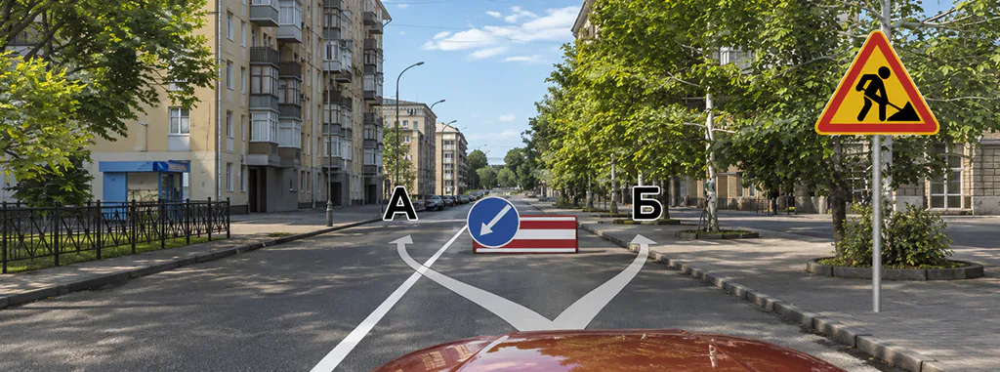

A/B, билет 35, вопрос 5. Иллюстрация из базы приложения.

Вы можете объехать препятствие:

- Только по траектории А
- Только по траектории Б
- По любой траектории из указанных

Показать ответ и разбор

Ответ 1: Только по траектории А. Знак 4.2.2 предписывает объезд слева — по траектории А. При противоречии знака и горизонтальной разметки руководствуются знаком. Наличие препятствия само по себе не означает произвольный выбор стороны.

На картинке действительно есть перекрывший путь объект. Но вопрос проверяет не только его наличие: знак задаёт сторону объезда. Конфликт со сплошной линией решается правилом приложения о приоритете знака над горизонтальной разметкой при их противоречии. Это конкретное основание, а не общий принцип «препятствие разрешает пересечь сплошную».

### Задача 2: поворачивающий грузовик не открывает обочину

#### A/B, билет 27, вопрос 10

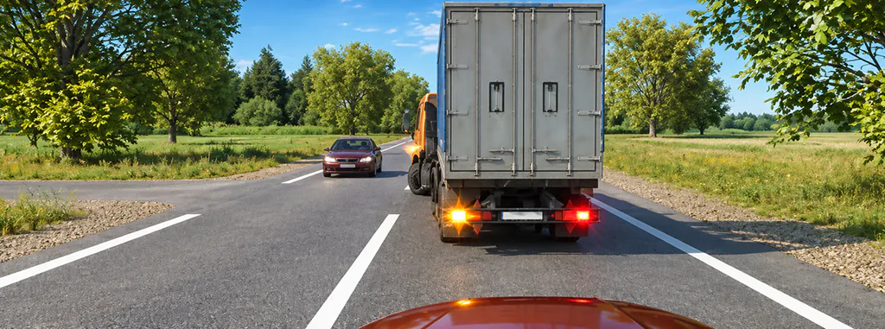

A/B, билет 27, вопрос 10. Иллюстрация из базы приложения.

Каковы Ваши действия в данной ситуации?

- Объедете грузовой автомобиль справа по обочине
- Продолжите движение только после того, как грузовой автомобиль освободит полосу движения
- Допускаются оба варианта действий

Показать ответ и разбор

Ответ 2: Продолжите движение только после того, как грузовой автомобиль освободит полосу движения. В данной ситуации предложенный объезд справа ведёт на обочину. Пункт 9.9 запрещает её использовать как обычную полосу движения. Нужно дождаться освобождения полосы грузовиком; ответ не даёт общего запрета на всякое опережение справа в иных условиях.

Полезно сопоставить варианты буквально. В первом предлагается не просто «справа», а «справа по обочине». Выбрать его из-за видимого свободного места — значит потерять существенное условие. Верный ответ относится к показанной ширине и расположению дороги, а не устанавливает правило всегда ждать позади любого поворачивающего автомобиля.

### Задача 3: очередь у закрытого переезда

#### A/B, билет 2, вопрос 16

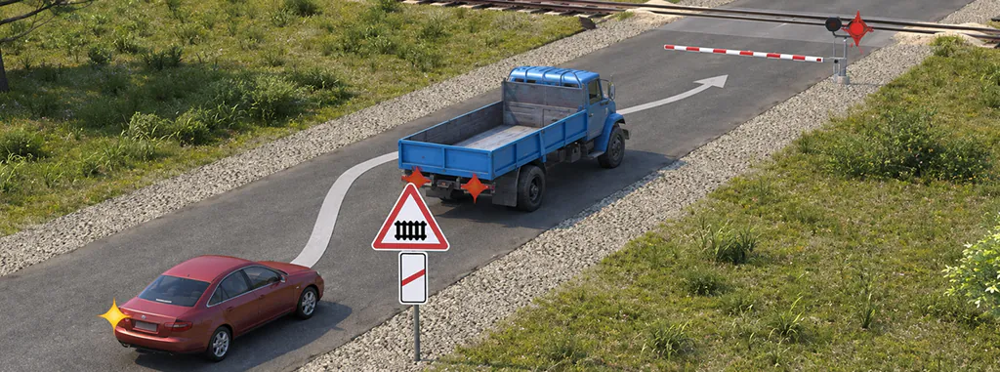

A/B, билет 2, вопрос 16. Иллюстрация из базы приложения.

Разрешается ли водителю выполнить объезд грузового автомобиля?

- Разрешается
- Разрешается, если между шлагбаумом и остановившимся грузовым автомобилем расстояние более 5 м
- Запрещается

Показать ответ и разбор

Ответ 3: Запрещается. Пункт 15.3 запрещает объезжать стоящие перед переездом транспортные средства с выездом на встречную полосу. Предположение о расстоянии более пяти метров до шлагбаума этот запрет не отменяет.

Вопрос употребляет обычное слово «объезд», но это не превращает грузовик в препятствие, которое можно обойти любым способом. Здесь есть самостоятельный прямой запрет п. 15.3. Вариант про расстояние до шлагбаума добавляет число, но не создаёт исключения из запрета выезда на встречную полосу.

### Почему название не заменяет проверку траектории

Два разных манёвра могут нарушать одно и то же ограничение направления движения. И наоборот: похожий внешне объезд в одной задаче организован знаком, а в другой предполагает запрещённый выезд. Поэтому после определения объекта задайте ещё два вопроса: «Куда попадёт моя машина?» и «Что разрешает именно этот выезд?».

Отдельно проверяйте движение по обочине. В ПДД есть специальные исключения для отдельных случаев и участников, но обычному водителю нельзя использовать её как дополнительную полосу только потому, что впереди задержка. В разобранной сцене с грузовиком условие таких исключений не содержит.

### Четыре строки для разбора ошибки

- Состояние объекта. Движется, ожидает по правилам или неподвижен из-за повреждения либо другой причины? Не угадывайте неисправность по одному включённому сигналу.
- Признак манёвра. Опережаете транспорт с выездом на встречную и возвращением или объезжаете перекрывший полосу неподвижный объект?
- Траектория. По своей полосе, другой полосе, встречной стороне или обочине? Запишите это словами до выбора варианта.
- Применимое ограничение. Укажите знак, разметку либо конкретный пункт для переезда и другого участка. Если такого обоснования нет, слово «объезд» его не заменяет.

Повторяя задачу, измените в уме один признак: вместо повреждённого автомобиля — ожидающий зелёного; вместо организующего знака — только разметка. Не пытайтесь сразу придумать универсальный ответ для всех вариантов. Цель упражнения — увидеть, почему изменение условия требует заново применить Правила.

Общие условия начала и завершения обгона разобраны в [справочнике обгона и опережения](https://pdd-drive.ru/blog/obgon-i-operezhenie-pdd/). Сохраните эту статью для другой задачи: прежде чем решать, разрешён ли манёвр, правильно назвать происходящее и прочитать предложенный путь.

### Частые вопросы

#### Затор является препятствием?

Нет. Пункт 1.2 прямо исключает затор из понятия препятствия. Стоящий по требованиям ПДД транспорт также нельзя автоматически считать препятствием.

#### Настоящее препятствие разрешает пересечь любую сплошную?

Нет. Нужно отдельное основание для выбранной траектории и соблюдение остальных требований. В примере 35–5 направление задаёт знак, противоречащий разметке.

#### Можно объехать задержавшийся грузовик по обочине?

Обычная задержка впереди не разрешает использовать обочину как полосу движения. В задаче 27–10 правильный ответ — дождаться освобождения полосы.

### Источники

- [ПДД, п. 1.2: обгон и препятствие](https://www.consultant.ru/document/cons_doc_LAW_2709/5894b193fda5648afe1c1a5e70c028f25cd29099/)
- [ПДД, п. 9.9: движение по обочине](https://www.consultant.ru/document/cons_doc_LAW_2709/d08dbb6ef3956314fd36b1d54a9393598f057acf/)
- [ПДД, п. 15.3: запрет объезда очереди на встречной полосе перед переездом](https://www.consultant.ru/document/cons_doc_LAW_2709/30652b56dc31f25e043cecc891a1b6c6d342b564/)
- [ПДД, знаки 4.2.1–4.2.3: сторона объезда](https://www.consultant.ru/document/cons_doc_LAW_2709/cfcce287ebd89cee09dc5b780337286c556b0978/)
- [ПДД, приложение 2: противоречие знака и горизонтальной разметки](https://www.consultant.ru/document/cons_doc_LAW_2709/8b4d779e30a40c4f48df8edd7c7d2e1a12e91d77/)
- [Госавтоинспекция: экзаменационные билеты A/B](https://гибдд.рф/mens/avtovladeltsam/abm)

### Практика после статьи

**Разберите траекторию до выбора ответа**

Откройте вопросы по расположению транспорта и разметке. Назовите объект впереди и полосу, на которую собираетесь выехать.

[Перейти к вопросам по темам](https://pdd-drive.ru/app/)
